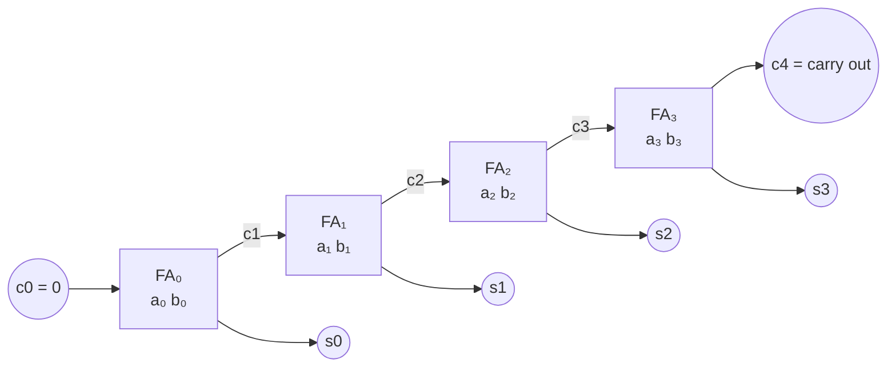

# Ripple-Carry Adder

## What it is
To add two `n`-bit binary numbers `a` and `b` chain `n` [full adders](#/combinational_circuits): stage `i` adds bits `aᵢ`, `bᵢ` and the carry `cᵢ` from the previous stage, producing sum bit `sᵢ` and carry `cᵢ₊₁`. This is the schoolbook algorithm cast in hardware.

## How it works

Correctness follows by induction on `i` using the invariant `Σ_{j<i} 2ʲ(aⱼ + bⱼ) = Σ_{j<i} 2ʲ sⱼ + 2ⁱ cᵢ`.

The **critical path** is the carry chain: `c_{i+1}` is available only after `c_i`, so depth grows by 2 per stage (AND then OR in each full adder).

## Complexity
Size `5n` gates; depth `2n + 1`: both `Θ(n)`.

## When to use it
Small word sizes, area-constrained designs, FPGAs (which have dedicated fast carry chains), and as the final stage inside larger multipliers when the operand is short. For speed use a [carry-lookahead adder](#/carry_lookahead_adder).

## In this implementation
`build_ripple` appends the adder to any `Circuit` so other designs ([array multiplier](#/multiplier_circuits)) can reuse it; tests assert exact gate count (`5n`), depth (`2n+1`), and correctness on random operands.
