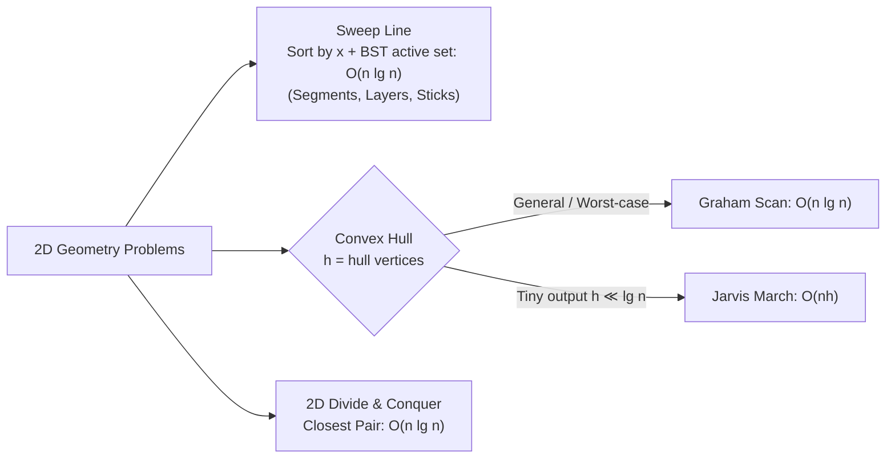

# Computational Geometry

## Introduction
Before your game engine renders a shadow, your GIS app finds the nearest coffee shop, or a robotics planner checks whether a robot arm clips a wall, software has to answer geometric questions about points, lines, and polygons in 2D. Featured in **CLRS editions 1–3** (`Ch. 33` in 2e–3e, `Ch. 35` in 1e), Computational Geometry teaches one golden rule: **avoid fragile trigonometry (`atan2`, division slopes) whenever exact cross-products (`x1*y2 - x2*y1`) do the job cleanly without rounding bugs!**

## What Problem Is It Solving?
- **Exact geometric primitives without division/angles:** Decide turn direction (left/right/collinear) and whether two segments touch ([Segment Intersection](#/segment_intersection), [Point in Polygon](#/point_in_polygon)).
- **Detect intersections among $n$ segments fast:** Beat $O(n^2)$ pairwise checks using a vertical sweep line ([Any Segments Intersect](#/any_segments_intersect), [Picking Up Sticks](#/picking_up_sticks)).
- **Convex Hull & Layers:** Wrap a tight convex rubber band around $n$ points ([Graham's Scan](#/convex_hull_graham), [Jarvis's March](#/jarvis_march), [Convex Layers](#/convex_layers), [Maximal Layers](#/maximal_layers)).
- **Proximity & Planar Partitioning:** Find the two closest points in a 2D plane faster than $O(n^2)$ ([Closest Pair](#/closest_pair)) or pair red/blue points with non-crossing segments ([Ghostbusters](#/ghostbusters)).

## Algorithms & Trade-Offs

| Algorithm | Complexity | Output / Geometry Sensitivity | Key Trade-Off |
|---|---|---|---|
| **All-Pairs Check** vs. [Sweep-Line Segment Intersection](#/any_segments_intersect) | $\Theta(n^2)$ vs. **$O(n \lg n)$** | Detects *any* intersection among $n$ segments | Sweeping a vertical line $x$ from left to right only compares adjacent active segments in a balanced BST—slashing checks from $n^2/2$ to $O(n \lg n)$ (note: finding *all* $k$ intersections takes $O((n+k)\lg n)$). |
| [Graham's Scan](#/convex_hull_graham) vs. [Jarvis's March](#/jarvis_march) | $\Theta(n \lg n)$ vs. **$O(nh)$** ($h$ = hull size) | Convex hull of $n$ points | Graham's Scan sorts all points once by polar angle then sweeps linearly—always $\Theta(n \lg n)$. Jarvis's March ("gift wrapping") wins when the hull has very few points ($h = o(\lg n)$), **but** degrades to $\Theta(n^2)$ when all points lie on a circle ($h = n$)! |
| **Brute-Force Distances** vs. [Closest Pair D&C](#/closest_pair) | $\Theta(n^2)$ vs. **$O(n \lg n)$** | Minimum Euclidean distance | Splitting at median $x$ only requires checking **at most 7 neighbors** per point inside the width-$2\delta$ middle strip—proving why 2D geometry doesn't force quadratic distance checks. |
| **Ray Casting** vs. **Winding Number** ([Point in Polygon](#/point_in_polygon)) | Both $\Theta(n)$ per query | Works on non-convex polygons | Even-odd ray casting is simple to trace (`crossings % 2 == 1`) **if** horizontal/vertex edge cases are handled carefully; winding number tracks signed turns cleanly on self-overlapping shapes. |
| **Ham-Sandwich Bisection** ([Ghostbusters](#/ghostbusters)) | $O(n^2 \lg n)$ divide & conquer | Exact non-crossing pairing | Recursively finding a line splitting red and blue points evenly guarantees zero crossing segments, at higher recursive cost than arbitrary pairings. |

## Quick Rules of Thumb for CS Students
- **Use cross products, never slopes (`dy / dx`):** Cross products `(p1 - p0) × (p2 - p0)` stay 100% exact on integers (`i64` / `i128`) and never divide by zero on vertical lines!
- **Output-sensitive algorithms shine when $h$ is small:** Comparing [Graham's Scan](#/convex_hull_graham) ($O(n \lg n)$) vs. [Jarvis's March](#/jarvis_march) ($O(nh)$) is the textbook example of **input-size** vs. **output-sensitive** complexity.
- **Why the 7-neighbor packing trick works:** In [Closest Pair](#/closest_pair), you can pack only finitely many $\ge \delta$-separated points inside a $\delta \times 2\delta$ box—so scanning sorted-$y$ strip neighbors takes $O(1)$ per point, keeping the recurrence $T(n) = 2T(n/2) + O(n)$.
