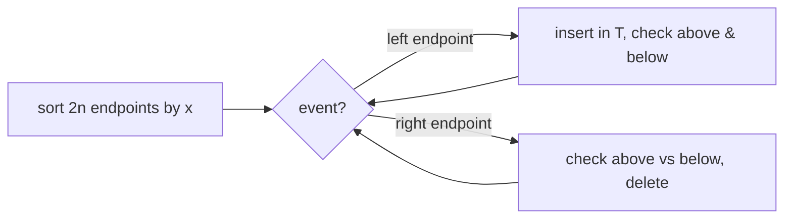

# Sweep Line: Do Any Two Segments Intersect?

## What it is
Given `n` line segments, decide whether **any two** intersect. All pairs would take `Θ(n²)`; the **Shamos–Hoey sweep-line algorithm** (1976) needs only `O(n lg n)` — and it does not need to *find* all intersections, which can number `Θ(n²)`, just to detect one.

## How it works
Sweep an imaginary vertical line from left to right. At any position the segments that cross the line are totally ordered by their y-coordinate (as long as no two have intersected yet). Maintain that order in a balanced search tree `T` (the *sweep-line status*). Events happen only at segment endpoints:

* **Left endpoint** — insert the segment into `T`; test it against its **new neighbours** above and below.
* **Right endpoint** — test the segment's neighbours against each other (they become adjacent), then delete it.

**Why checking neighbours suffices** (Theorem 33.1): if an intersection exists, consider the leftmost one at point `p`. Just before the sweep reaches `p`, the two segments are adjacent in `T`, hence tested at one of the events that made them adjacent. Before the first intersection the order never changes, so the algorithm is correct; it may stop at the first positive test.

## Complexity
`O(n lg n)`: sorting plus `2n` events, each with `O(lg n)` tree operations and `O(1)` intersection tests. (This implementation uses a sorted `Vec` for `T`, so inserts cost `O(n)` — same asymptotics with a balanced tree such as the [red-black tree](#/red_black_tree).)

## When to use it
Collision detection among edges, validity checks of polygons (simple polygon test), VLSI design-rule checking, and as the basis of Bentley–Ottmann for reporting all intersections.

## In this implementation
Exact comparisons by cross-multiplication in `i128`; the book's assumptions (no vertical segments, no three segments through a point) are documented — if a vertical segment is present the code falls back to the all-pairs test. 600 random instances are verified against the all-pairs check, with balanced yes/no cases.
