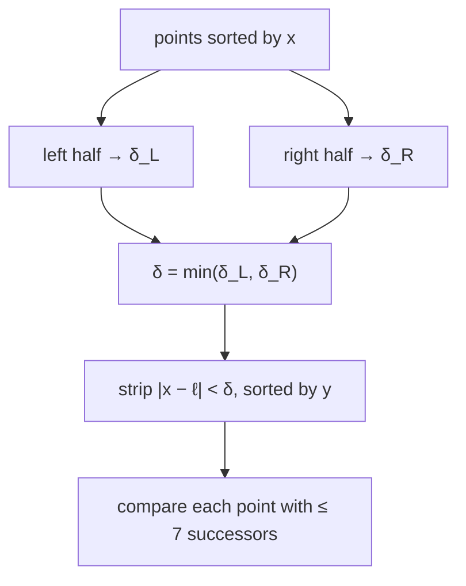

# Closest Pair of Points

## What it is
Given `n ≥ 2` points in the plane, find two whose Euclidean distance is smallest. Checking all pairs costs `Θ(n²)`; a divide-and-conquer algorithm achieves `Θ(n lg n)` (Section 33.4), matching the lower bound in the algebraic decision-tree model.

## How it works
Presort the points by `x` and (recursively, by merging) by `y`.
1. **Divide** with a vertical line `ℓ` at the median `x`, giving left and right halves.
2. **Conquer**: find the closest pairs `δ_L, δ_R` in each half; let `δ = min(δ_L, δ_R)`.
3. **Combine**: a closer pair must straddle `ℓ`, with both points within `δ` of it — a vertical strip. Scan the strip's points in **y order**: each point only needs to be compared with the next **7** points, because a `δ × 2δ` rectangle can hold at most 8 points that are pairwise at least `δ` apart (packing argument).

Recurrence `T(n) = 2T(n/2) + O(n) = O(n lg n)` (the y-order is maintained by *merging*, as in [merge sort](#/merge_sort)).

## Complexity
`Θ(n lg n)` time, `Θ(n)` space.

## When to use it
Collision detection, clustering seeds, air-traffic conflict alerts, nearest-neighbour preprocessing. Randomised grid-based algorithms achieve expected `O(n)`.

## In this implementation
Squared integer distances avoid square roots; ties and duplicate points work (distance 0). 300 random inputs on a 51×51 grid (many ties) are compared with brute force.
