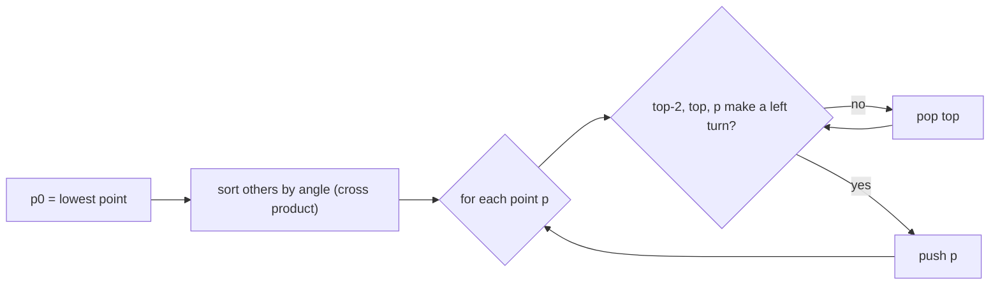

# Convex Hull: Graham's Scan

## What it is
The **convex hull** of a point set `Q` is the smallest convex polygon containing all points — intuitively, the shape of a rubber band stretched around nails on a board. Graham's scan (1972) computes it in `O(n lg n)`.

## How it works
1. Let `p₀` be the lowest point (leftmost on ties); it is certainly a hull vertex.
2. Sort the remaining points by **polar angle** around `p₀` (compare two points with a cross product — no trigonometry). If several share an angle keep only the farthest.
3. Push `p₀` and the first two sorted points on a **stack**. For each further point `pᵢ`: while the angle formed by the top two stack entries and `pᵢ` does **not make a left turn**, pop; then push `pᵢ`.

At the end the stack holds the hull vertices in counter-clockwise order. Popping is justified because a non-left turn means the stack's top point lies inside the triangle (or on the edge) formed by its neighbours and `pᵢ`.

## Complexity
`O(n lg n)`: dominated by sorting; the scan is `O(n)` because every point is pushed once and popped at most once (an [amortised](#/multipop_stack) argument).

## When to use it
Computer graphics (bounding shapes, collision hulls), pattern recognition, GIS, finding the diameter of a point set (rotating calipers on the hull), and as a preprocessing step in many geometry algorithms. For small hulls [Jarvis march](#/jarvis_march) can be faster.

## In this implementation
Integer coordinates, exact orientation tests; collinear boundary points are removed. Tests check strict convexity, that all input points lie inside, and degenerate inputs (empty, duplicate, collinear).
