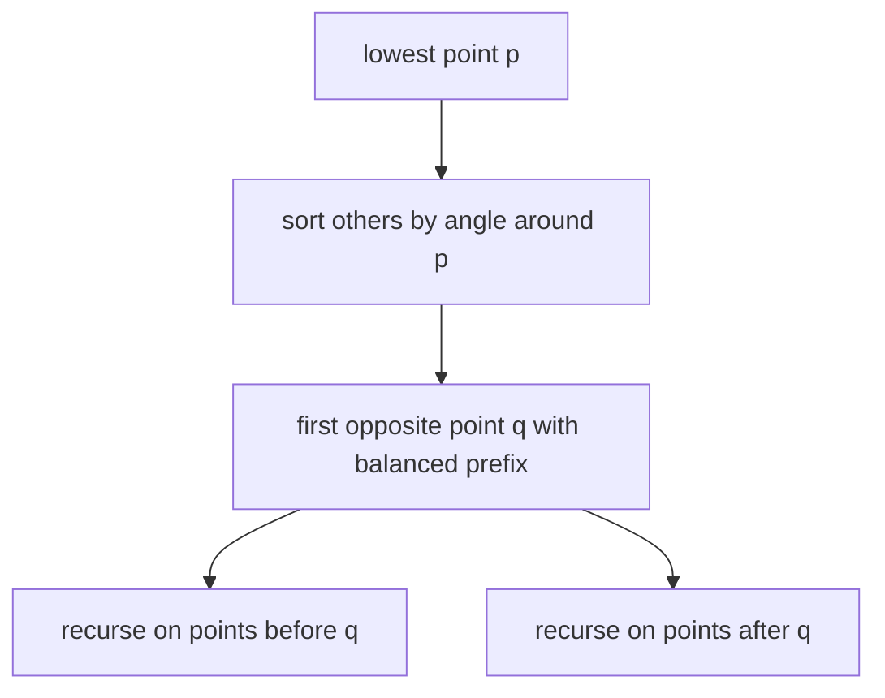

# Ghostbusters and Ghosts

## What it is
`n` ghostbusters and `n` ghosts stand at distinct points of the plane, no three collinear. Each ghostbuster must fire a proton beam in a straight line at one ghost, and a beam stops when it hits the ghost; no two beams may **cross** (that would be dangerous!). Problem 33-4 asks for a pairing of busters to ghosts whose connecting segments are pairwise disjoint.

## How it works
Two classical solutions:
* **Minimum total length.** A perfect matching of minimum total Euclidean length has no crossing: if two segments `ac` and `bd` crossed, replacing them by `ad` and `bc` would be strictly shorter (triangle inequality, strict since no three points are collinear). Repeated "uncrossing" therefore terminates.
* **Divide and conquer (used here).** Take the lowest point `p` (leftmost on ties) and sort the others by **polar angle** around `p`. Scan counter-clockwise keeping the balance `#(same type as p) − #(opposite type)`. Total balance of the others is `−1`, so at some point the balance is `0` just before an opposite-type point `q`: match `p` with `q`. The points before `q` and the points after `q` each contain equally many busters and ghosts and lie on opposite sides of the line `pq`, so the recursive matchings cannot cross each other or `pq`.

## Complexity
`O(n lg n)` per level of recursion; `O(n² lg n)` worst case (unbalanced splits), `O(n lg² n)` expected for random inputs, and `O(n lg n)` is possible with a ham-sandwich cut.

## When to use it
Non-crossing bichromatic matchings arise in routing (connecting sources to sinks without wire crossings), in matching red/blue point sets, and as an elegant application of angular sweeps and the [cross product](#/segment_intersection).

## In this implementation
Coordinates are integers and orientation tests are exact. Tests generate 200 random inputs with no three collinear points and verify that the pairing is perfect, bichromatic and that no two segments cross.
