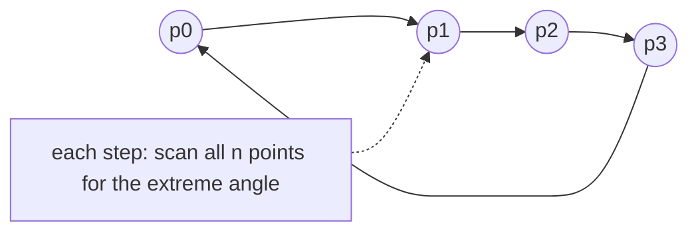

# Convex Hull: Jarvis's March

## What it is
**Jarvis's march** (1973), also called *gift wrapping*, computes the convex hull the way you would wrap a present: start at a vertex known to be on the hull and repeatedly find the next one by rotating a ray around the current vertex until it touches a point.

## How it works
1. Start at the lowest point `p₀` (a guaranteed hull vertex).
2. From the current vertex `pₖ`, the next vertex `pₖ₊₁` is the point with the **smallest polar angle** with respect to `pₖ` (ties: the farthest). Find it with one linear scan using cross products.
3. Repeat until returning to `p₀`.

The first half of the walk builds the *right chain* up to the highest point, the second half the *left chain* — the original pseudocode runs two such sweeps, the version here wraps all the way around in one loop.

## Complexity
`O(n h)` where `h` is the number of hull vertices — **output sensitive**. Better than [Graham's scan](#/convex_hull_graham) (`O(n lg n)`) when `h < lg n`; worse when most points are on the hull (`h = n` gives `O(n²)`). Chan's algorithm combines both ideas for `O(n lg h)`, which is optimal.

## When to use it
Small hulls, streaming/pre-filtered point sets, and as the simplest convex hull to implement correctly. It generalises to 3-D (gift-wrapping on faces).

## In this implementation
Exact integer arithmetic; collinear points are skipped by taking the farthest on the same ray. Tests assert exact equality with the Graham-scan output on 300 random point sets with many collinearities.
