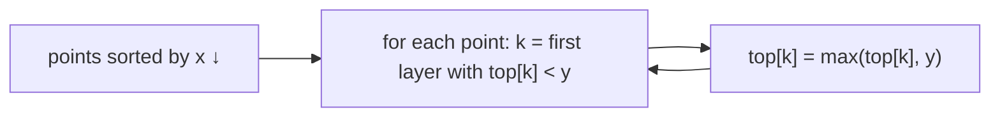

# Maximal Layers

## What it is
A point `p = (x, y)` **dominates** `q` if `p ≠ q`, `p.x ≥ q.x` and `p.y ≥ q.y`. The **maximal** points of a set are those dominated by nobody (the Pareto front). The **maximal layers** peel the set repeatedly: layer 0 is the maximal set, layer 1 the maximal points of what is left, and so on. Problem 33-2 asks for an `O(n lg n)` algorithm to find all layers — the number of layers equals the length of the longest chain `p₁ ≺ p₂ ≺ …` of dominated points, and is exactly the quantity computed by [longest increasing subsequence](#/longest_increasing_subsequence).

## How it works
Sweep the points from right to left (decreasing `x`, ties by decreasing `y`), keeping for each layer `k` the largest `y` seen so far, `top[k]`. Because every point in layer `k+1` is dominated by some point in layer `k`, the array `top` is **non-increasing**. A new point with ordinate `y` is dominated exactly by points in layers whose `top ≥ y`, so it belongs to the first layer with `top < y`: found with a **binary search**. Update that layer's top. This is the "patience sorting" structure behind LIS.

## Complexity
`O(n lg n)` (sorting plus one binary search per point); the naive peeling is `O(n²)` per layer pair.

## When to use it
Skyline queries in databases (the first layer is the skyline), multi-criteria ranking (rank products by Pareto optimality), and computing longest chains in 2-D dominance orders.

## In this implementation
`maximal_layers` is compared with the quadratic peeling procedure on 300 random point sets with duplicates removed, plus a staircase (one layer) and a diagonal chain (n layers).
