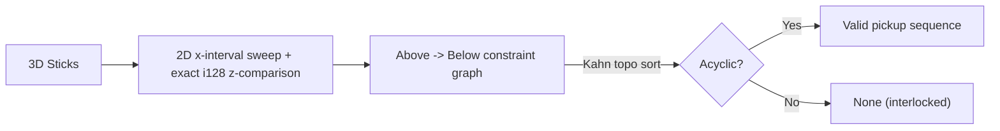

# Picking Up Sticks

## What it is
Given $n$ line segments ("sticks") lying in 3D space whose 2D projections cross in the $xy$-plane, **Picking Up Sticks** asks whether all $n$ sticks can be lifted straight up one by one without colliding with an overlying stick — and, if so, outputs a valid lifting order.

## How it works
1. **Crossing geometry**: Sweep segments sorted by $x_{\min}$ (using `segments_intersect` from [line-segment intersection](#/segment_intersection) and related sweep ideas in [any segments intersect](#/any_segments_intersect)). Whenever two 2D projections cross properly, solve the exact rational $t, u$ intersection parameters using `i128` arithmetic to compare $z_a$ vs $z_b$ at the crossing point without floating-point error.
2. **Precedence DAG & [topological sort](#/topological_sort)**: Whenever stick $a$ lies strictly above stick $b$ at their crossing, add directed constraint $a \to b$ ("$a$ must be lifted before $b$"). Run Kahn's in-degree topological sort (`pick_up_sticks`); a valid sequence exists if and only if the constraint graph is acyclic (an interlocking 3-stick Escher pinwheel forms a 3-cycle and returns `None`).

## Complexity
* **Topological sort**: $O(n + |E_{\text{cross}}|)$ time.
* **Geometric intersection detection**: $O((n + k) \lg n)$ with event-queue sweep-line; $O(n^2)$ worst-case when $k = \Theta(n^2)$ crossings exist.

## When to use it
In 3D CAD disassembly planning, painter's algorithm visibility ordering, and geometric scheduling whenever spatial overlaps induce partial-order dependencies.

## In this implementation
`pick_up_3d_sticks` and `pick_up_sticks` check 50 randomized multi-layer 3D piles verifying all `pos[above] < pos[below]` invariants, and confirm cyclic detection on an explicit 3D interlocking pinwheel triangle.
