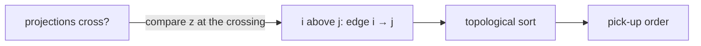

# Picking Up Sticks

## What it is
A pile of `n` sticks (think pick-up-sticks or mikado) lies on a table. Each stick is a line segment in 3-D. You may lift one stick at a time, and a stick can be lifted only if **no other stick lies on top of it** — otherwise the pile would shift. Problem 33-4 asks for an algorithm that decides whether the sticks can all be removed, and in which order. It combines [segment-intersection tests](#/segment_intersection) with [topological sorting](#/topological_sort).

## How it works
1. Project the sticks onto the table (the `xy` plane). Two sticks can only rest on one another where their projections **cross**.
2. At a crossing compute each stick's height `z` there (linear interpolation along the stick); the higher one **lies on** the lower one. This defines a directed graph "`i` must be lifted before `j`".
3. For a real pile the graph is **acyclic**, so a [topological order](#/topological_sort) is a valid sequence of removals. If the relation had a cycle no order would exist (and the configuration is physically impossible).
The `O(n²)` pair test here can be replaced by the sweep-line machinery of [Section 33.2](#/any_segments_intersect), which finds the "directly above" relation in `O(n lg n)` (only *adjacent* sticks in the sweep order matter).

## Complexity
`O(n²)` pair tests plus `O(n²)` topological sort here; `O(n lg n)` with a sweep.

## When to use it
Assembly/disassembly planning (which part can be removed next), rendering order for overlapping objects (painter's algorithm: draw the lowest first), and layered dependency problems.

## In this implementation
Sticks use `f64` coordinates. Tests check that sticks at distinct constant heights can always be lifted (200 random piles), that returned orders satisfy every pairwise "above" constraint even for tilted sticks, and that a cyclic arrangement is rejected.
