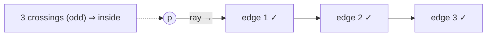

# Point in Polygon

## What it is
Given a simple polygon (not necessarily convex) and a query point `p`, decide whether `p` is **inside**, **on the boundary**, or **outside**. Chapter 33 builds the toolbox — cross products, orientation tests, [segment intersection](#/segment_intersection) — and its exercises ask for exactly this application (the other standard exercise is the polygon's area via the shoelace formula).

## How it works
* **Ray casting / even–odd rule.** Shoot a horizontal ray from `p` to the right and count how many polygon edges it crosses. An odd count means inside. An edge is counted when its endpoints lie on different sides of the line `y = p.y` (using a half-open test `a.y > p.y` to avoid double-counting vertices on the ray), and the crossing is to the right of `p` — decided exactly by the sign of a **cross product**, with no division.
* **Winding number.** Walk around the polygon and add `+1` for an upward edge with `p` on its left, `−1` for a downward edge with `p` on its right. A non-zero total means inside. For simple polygons both rules agree; for self-intersecting polygons they differ.
* **Boundary** is detected first by testing whether `p` is collinear with an edge and within its bounding box.
* **Area** by the shoelace formula `½ Σ (xᵢ yᵢ₊₁ − xᵢ₊₁ yᵢ)` (positive for counter-clockwise order).

## Complexity
`O(n)` per query, `O(1)` extra space. For many queries on the same polygon, preprocess with a trapezoid or slab decomposition for `O(lg n)` queries.

## When to use it
Hit-testing in graphics and GIS, point-location in maps, collision detection, and as a building block for polygon clipping.

## In this implementation
All arithmetic is exact (`i64`). Tests compare both rules with direct tests for random rectangles in both orientations (including boundary points), check that they agree on 100 random star-shaped polygons, and cover a concave notch.
