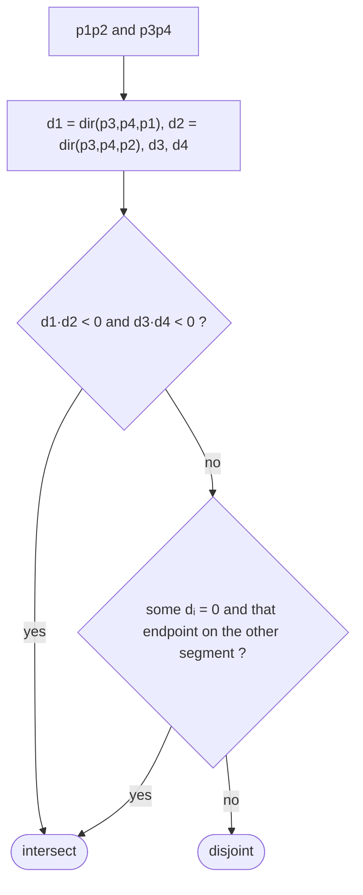

# Line-Segment Properties & Intersection

## What it is
**Computational geometry** studies algorithms for geometric objects. (Chapter 33 appears in the first three editions; the 4th edition removed it as rarely taught.) All its primitives rest on the **cross product**, which can be evaluated with additions and multiplications only — no division, no angles, no floating-point error if the coordinates are integers.

## How it works
For points `p₀, p₁, p₂`, the cross product `(p₁ − p₀) × (p₂ − p₀) = (x₁−x₀)(y₂−y₀) − (x₂−x₀)(y₁−y₀)` is
* `> 0` when `p₀p₂` is counter-clockwise from `p₀p₁` (a **left turn** at `p₁` going `p₀→p₁→p₂`),
* `< 0` for a right turn, and `0` when the three points are collinear.

**SEGMENTS-INTERSECT.** Segments `p₁p₂` and `p₃p₄` intersect iff
1. each segment **straddles** the line containing the other (the two cross products with respect to that line have opposite signs), or
2. an endpoint of one lies **on** the other (a zero cross product plus a bounding-box test, `ON-SEGMENT`).

## Complexity
O(1) arithmetic operations. Testing all pairs of `n` segments takes `Θ(n²)`; the [sweep-line algorithm](#/any_segments_intersect) decides *whether any pair intersects* in `O(n lg n)`.

## When to use it
Collision detection, map overlay in GIS, CAD, graphics clipping, robot motion planning, point-in-polygon tests.

## In this implementation
Integer coordinates with `i64` cross products. Tests compare against an independent exact rational solver on 5000 random segment pairs on a 7×7 grid, which exercises every degenerate case (touching, collinear, parallel).
