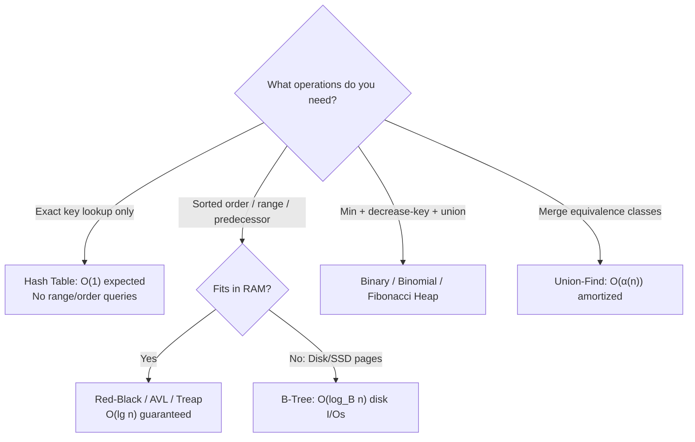

# Data Structures

## Introduction
Algorithms tell you *what steps to take*; data structures decide *how information sits in memory* so those steps are fast. In Part III and Part V of CLRS, you move from basic arrays, stacks, and linked lists to hash tables ($O(1)$ expected lookup), balanced search trees ($O(\lg n)$ guaranteed sorted operations), disk-friendly B-trees, mergeable heaps, and union-find sets. Every choice here is an engineering trade-off among lookup speed, memory overhead, worst-case predictability, and supported queries.

## What Problem Is It Solving?
- **Sequential & dynamic linear storage:** Push/pop/splice in $O(1)$ without contiguous resizing ([Stacks, Queues & Deques](#/stack_queue), [Linked Lists](#/linked_list), [Implementing Pointers](#/array_pointers_objects)).
- **Fast dictionary lookup (`insert`, `search`, `delete`):** Answer "is $x$ in the set?" in $O(1)$ expected time ([Hash Tables with Chaining](#/chained_hash_table), [Open Addressing](#/open_addressing), [Universal Hashing](#/hash_functions), [Perfect Hashing](#/perfect_hashing)).
- **Ordered dictionary & range queries (`min`, `successor`, `rank`, `overlap`):** Maintain dynamic sorted order in $O(\lg n)$ time ([BST](#/binary_search_tree), [Red-Black Trees](#/red_black_tree), [AVL Trees](#/avl_tree), [Treaps](#/treap), [Order-Statistic Trees](#/order_statistic_tree), [Interval Trees](#/interval_tree)).
- **Disk/SSD-blocked storage:** Minimize expensive disk reads when data doesn't fit in RAM ([B-Trees](#/b_tree), [2-3-4 Trees](#/two_three_four_tree)).
- **Fast priority queues & meld (`union`, `decrease-key`):** Speed up graph algorithms like Dijkstra ([Binomial Heaps](#/binomial_heap), [Fibonacci Heaps](#/fibonacci_heap), [2-3-4 Heaps](#/two_three_four_heap), [Pairing Heaps](#/pairing_heap)).
- **Integer universe & dynamic connectivity:** Beat $\Omega(\lg n)$ on small integers ([van Emde Boas Trees](#/van_emde_boas_tree)) or track connected components in nearly $O(1)$ ([Disjoint Sets](#/disjoint_set), [Ackermann $\alpha(n)$](#/ackermann_alpha)).

## Algorithms & Trade-Offs

| Structure | Lookup / Search | Insert / Delete | Ordered? | Key Trade-Off |
|---|---|---|---|---|
| [Chained Hash Table](#/chained_hash_table) vs. [Open Addressing](#/open_addressing) | $O(1)$ expected | $O(1)$ expected | No | Chaining handles high load factors gracefully using extra pointers; open addressing packs keys into one contiguous cache-friendly array, **but** degrades sharply as load $\alpha \to 1$. |
| [Universal Hashing](#/hash_functions) / [Perfect Hashing](#/perfect_hashing) | $O(1)$ expected / $O(1)$ worst | $O(1)$ / Static | No | Randomizing hash functions defeats adversarial keys; two-level FKS [Perfect Hashing](#/perfect_hashing) guarantees $O(1)$ **worst-case** lookup for static sets (like compiler keyword tables). |
| [Plain BST](#/binary_search_tree) vs. [Red-Black Tree](#/red_black_tree) / [AVL Tree](#/avl_tree) | $O(h)$ vs. $O(\lg n)$ | $O(h)$ vs. $O(\lg n)$ | Yes | Unbalanced BSTs collapse to $\Theta(n)$ height on sorted inserts! [AVL Trees](#/avl_tree) balance more tightly (faster lookups), while [Red-Black Trees](#/red_black_tree) do at most 2 rotations on insert and 3 on delete (faster writes, standard in `std::map`/Linux kernel). |
| [Treaps](#/treap) | $O(\lg n)$ expected | $O(\lg n)$ expected | Yes | Combines BST keys with random heap priorities—much simpler to code than Red-Black rotations, **but** gives probabilistic rather than deterministic height guarantees. |
| [B-Trees](#/b_tree) | $O(\lg n)$ CPU, $O(\log_t n)$ disk | $O(\lg n)$ CPU | Yes | High branching factor $t$ matches OS page size, slashing disk seeks from ~30 to ~3–4 for millions of rows. |
| [Fibonacci Heaps](#/fibonacci_heap) vs. [Pairing](#/pairing_heap) / [2-3-4 Heaps](#/two_three_four_heap) | $O(1)$ min | $O(1)$–$O(\lg n)$ | Priority only | Fibonacci heaps give $O(1)$ amortized `decrease-key` (cutting Dijkstra to $O(E + V \lg V)$), **but** high pointer overhead means [Pairing Heaps](#/pairing_heap) or binary heaps often beat them in real RAM. |
| [van Emde Boas Tree](#/van_emde_boas_tree) | $O(\lg \lg u)$ | $O(\lg \lg u)$ | Yes (ints $0..u$) | Exponentially faster than BSTs when universe $u$ is small/moderate, **but** uses $\Theta(u)$ space and only stores integer keys. |

## Quick Rules of Thumb for CS Students
- **Hash table vs. Balanced BST:** Default to a hash table when you only need exact lookups (`get`/`put`); switch to a balanced BST when you need sorted iteration, `lower_bound`, range queries, or strict worst-case guarantees against hash-flooding attacks.
- **Augmenting trees is a superpower:** Adding one extra field (`size` in [Order-Statistic Trees](#/order_statistic_tree), `max_high` in [Interval Trees](#/interval_tree)) unlocks $O(\lg n)$ rank/select and interval-overlap queries if the field can be recomputed from children in $O(1)$.
- **Union-Find is effectively constant time:** With path compression + union by rank, [Disjoint Sets](#/disjoint_set) runs in $O(\alpha(n))$ amortized where $\alpha(n) \le 4$ for every input size in the physical universe.
