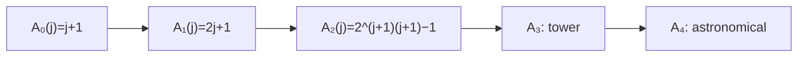

# The Ackermann Function and its Inverse α(n)

## What it is
The analysis of [disjoint-set forests](#/disjoint_set) with union by rank and path compression (Section 21.4) shows that a sequence of `m` operations on `n` elements runs in `O(m α(n))` time, where `α` is the **inverse of the Ackermann function** — a function that grows more slowly than any reasonable iterated logarithm. CLRS defines it through the hierarchy

`A₀(j) = j + 1`,  `A_k(j) = A_{k−1}^{(j+1)}(j)` for `k ≥ 1`

(the function `A_{k−1}` applied `j + 1` times to `j`), and `α(n) = min { k : A_k(1) ≥ n }`.

## How it works
The family climbs the hyperoperation ladder: `A₁(j) = 2j + 1` (doubling), `A₂(j) = 2^(j+1)(j + 1) − 1` (exponential), `A₃` is a tower of exponentials, `A₄` is beyond tower notation. The key values are

| k | A_k(1) |
|---|--------|
| 0 | 2 |
| 1 | 3 |
| 2 | 7 |
| 3 | 2047 |
| 4 | ≈ 2^2048 (more than the number of atoms in the universe, squared many times) |

so `α(n) ≤ 4` for all practical `n` (indeed for every `n < A₄(1)`), which is why union-find is "essentially constant time". It is *not* constant: Tarjan proved the `Ω(m α(n))` lower bound for the pointer-machine model, so the bound is tight.

## Complexity
Computing `A_k(j)` is only feasible for tiny arguments (values blow up immediately); `α(n)` needs only the four thresholds above.

## When to use it
To understand the exact bound of union-find, and as the classic example of a total computable function that is not primitive recursive (Ackermann's original two-argument function).

## In this implementation
Values are computed with checked `u128` arithmetic — `None` means "exceeds 128 bits". Closed forms for `k = 1, 2` are verified against the literal iterated definition; `α` is tested at every threshold (`α(2)=0`, `α(3)=1`, `α(7)=2`, `α(2047)=3`, `α(2048)=4`, `α(u128::MAX)=4`).
