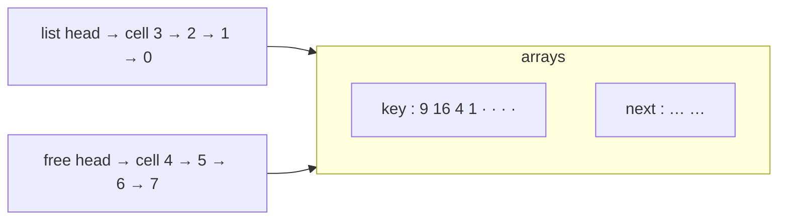

# Implementing Pointers and Objects

## What it is
Some languages have no pointers or records. Section 10.3 (1st–3rd editions; removed in the 4th) shows how to simulate linked structures using **arrays**: one array per attribute (`key[]`, `next[]`, `prev[]`) with an index playing the role of a pointer.

## How it works
Unused cells are linked into a **free list** (a singly linked stack through `next`). `ALLOCATE-OBJECT` pops the head of the free list; `FREE-OBJECT` pushes the cell back. All operations are O(1), so the whole list manager is O(1) per operation and needs no garbage collector.

Exercise 10.3-4 asks for a **compaction**: move all `m` live objects to the first `m` cells so the free storage is contiguous (improves locality and lets memory be returned).

## Complexity
Allocate / free: Θ(1). Compaction: Θ(n) (this implementation copies; the exercise's in-place variant uses O(1) extra storage).

## When to use it
Embedded or GPU code without dynamic allocation, arena allocators, and the index-based graph/tree structures used throughout this repository.

## In this implementation
`MultiArrayList` stores the three attribute arrays and the free-list head explicitly; the tests check reuse of freed cells and that compaction preserves list order.
