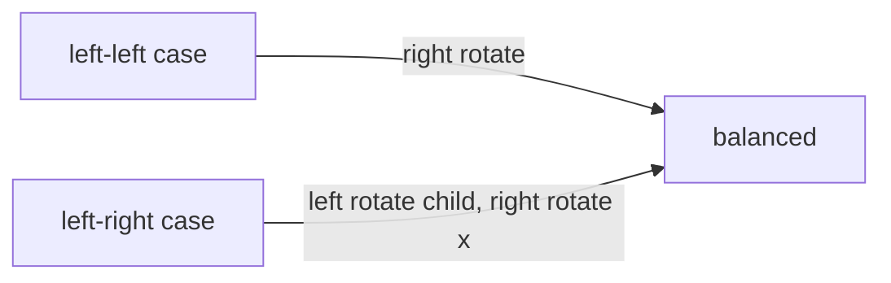

# AVL Trees

## What it is
The first self-balancing BST (Adelson-Velsky & Landis, 1962). An AVL tree is **height-balanced**: for every node, the heights of its left and right subtrees differ by at most 1. CLRS develops it in Problem 13-3 as an alternative to [red-black trees](#/red_black_tree).

## How it works
Store the height in every node. After an insertion or deletion, walk back up and call `BALANCE(x)`:
* if the left subtree is two levels taller, apply a **right rotation** (after a *left* rotation of the left child if that child leans right — the "left-right" double rotation);
* symmetrically for a right-heavy node.

Part (e) of the problem shows that an AVL tree with `n` nodes has height `≤ 1.4405 lg(n+2)`; the minimum number of nodes for height `h` follows the Fibonacci recurrence `N(h) = N(h−1) + N(h−2) + 1`.

## Complexity
Search, insert, delete: Θ(lg n) worst case; insertion needs at most one (single or double) rotation, deletion may need Θ(lg n).

## When to use it
Read-heavy ordered sets/maps — AVL trees are *more rigidly balanced* than red-black trees (height ≈ 1.44 lg n vs 2 lg n), so lookups are faster, while red-black trees do fewer rotations on updates.

## In this implementation
Pointer-based (`Option<Box<Node>>`) recursive insert/delete returning the new subtree root; `validate()` rechecks ordering, stored heights and the balance factor, and the tests run it under random operations.
