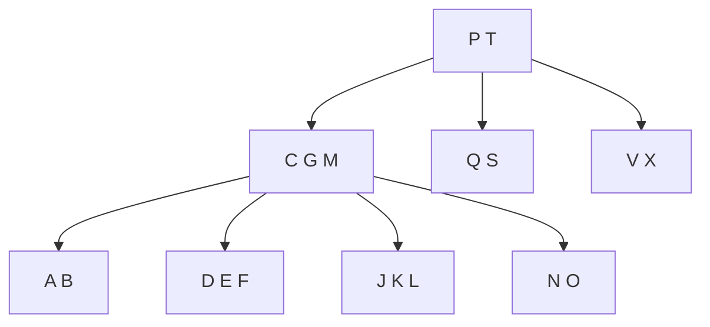

# B-Trees

## What it is
B-trees are balanced search trees designed for **secondary storage**: each node is one disk page that holds many keys, so the tree is very shallow and a search touches only `O(log_t n)` pages. They are the index structure of databases and file systems.

## How it works
A B-tree with **minimum degree** `t ≥ 2`:
* every node other than the root has at least `t − 1` keys and every node at most `2t − 1`;
* an internal node with `k` keys has `k + 1` children, whose key ranges are separated by its keys;
* all leaves have the same depth.

**Insert** splits any *full* node (`2t−1` keys) on the way down, pushing its median key up — so the algorithm never has to back up.

**Delete** guarantees every node it descends into has at least `t` keys: if the key sits in an internal node, replace it by its predecessor/successor (if that child has ≥ `t` keys) or merge the two children around it; if the child to visit is minimal, *borrow* from a sibling or *merge* with one.

## Complexity
Height `h ≤ log_t((n+1)/2)`. Search, insert, delete: `Θ(t · log_t n)` CPU time and `Θ(log_t n)` disk accesses.

## When to use it
Databases, file systems (ext4 HTree, NTFS, HFS+), key-value stores. Variants: B⁺-trees (data only in leaves) and B*-trees. The 2-3-4 tree is the case `t = 2` and is isomorphic to a [red-black tree](#/red_black_tree).

## In this implementation
Vec-based nodes with owned children. `validate()` checks key-count bounds, ordering and uniform depth; the tests compare with `BTreeSet` for `t = 2, 3, 5, 8` and check the `log_t` height bound.
