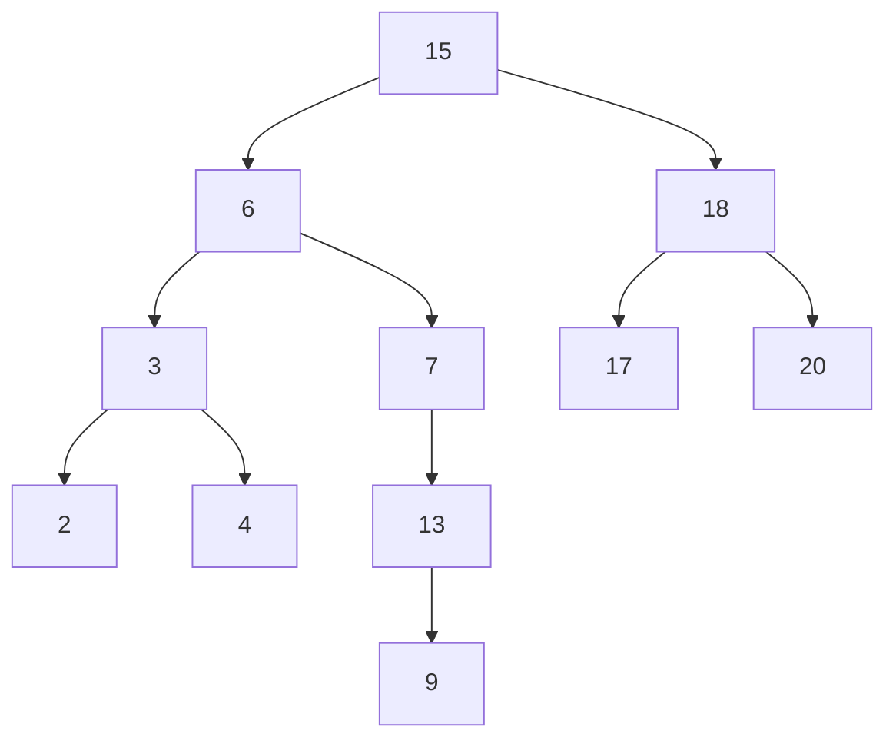

# Binary Search Trees

## What it is
A **binary search tree (BST)** keeps keys in a binary tree satisfying the *BST property*: for every node `x`, keys in its left subtree are `≤ x.key` and keys in its right subtree are `≥ x.key`. Most operations take time proportional to the tree's **height** `h`.

## How it works
* **Inorder walk** prints keys in sorted order in Θ(n).
* **Search / minimum / maximum** follow left or right pointers — O(h).
* **Successor** is the minimum of the right subtree, or the lowest ancestor whose left subtree contains `x`.
* **Insert** walks down like a search and attaches the new leaf.
* **Delete(z)** has three cases: no left child (replace `z` with its right child), no right child (replace with left child), or two children (replace `z` with its successor `y`, first moving `y` out of the way). The helper `TRANSPLANT(u, v)` replaces the subtree rooted at `u` by the one at `v`.

## Complexity
All dictionary operations are O(h): Θ(lg n) for a balanced tree, Θ(n) in the worst case (keys inserted in sorted order). [Randomly built trees](#/randomly_built_bst) have expected height O(lg n); [red-black trees](#/red_black_tree), [AVL trees](#/avl_tree), [treaps](#/treap) and [B-trees](#/b_tree) guarantee it.

## When to use it
Ordered dictionaries needing min/max/successor queries and range scans, as the base for balanced trees and augmented structures such as [order-statistic trees](#/order_statistic_tree).

## In this implementation
An arena (`Vec<Node>`) with parent indices avoids `unsafe`; deleted nodes are unlinked but stay in the arena. A randomized test checks every operation against `BTreeSet`.
