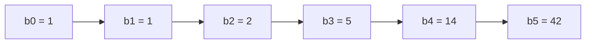

# Counting Binary Trees & BST Shapes

## What it is
Problem 12-4 counts **distinct binary trees**: how many different shapes can a binary tree with `n` nodes have? The answer, the **Catalan number**, appears throughout algorithm analysis (parenthesisations in [matrix-chain multiplication](#/matrix_chain), triangulations of a polygon, [BST shapes](#/binary_search_tree)).

## How it works
Let `bₙ` be the number of binary trees with `n` nodes. Pick the left subtree size `k`; the right subtree then has `n − 1 − k` nodes:

`b₀ = 1`, `bₙ = Σ_{k=0}^{n−1} b_k · b_{n−1−k}`.

Using generating functions `B(x) = Σ bₙxⁿ` satisfies `B(x) = x·B(x)² + 1`, which gives `bₙ = C(2n, n)/(n+1)` and asymptotically `4ⁿ/(√π·n^{3/2})` — exponentially many shapes.

Relation to [binary search trees](#/binary_search_tree): the `n!` insertion orders of distinct keys map onto only `bₙ` BST shapes, and *which* shapes are reached with which probability is what makes [randomly built trees](#/randomly_built_bst) shallow (the balanced shapes are hit far more often than the degenerate ones: the chain is reached by just 2^{n−1} orders).

## Complexity
`bₙ` computed in `O(n²)` by the recurrence or `O(n)` multiplications by the closed form; enumeration is `Θ(bₙ·n)`.

## When to use it
Estimating the size of search spaces over tree structures, enumerating all parse trees or triangulations in brute-force tests, and sanity checks in combinatorics.

## In this implementation
`all_shapes(n)` enumerates shapes as parenthesised strings; tests confirm the recurrence equals the closed form up to `n = 29`, that the `n!` permutations generate exactly the `bₙ` shapes, and the first terms `1, 1, 2, 5, 14, 42, …`.
