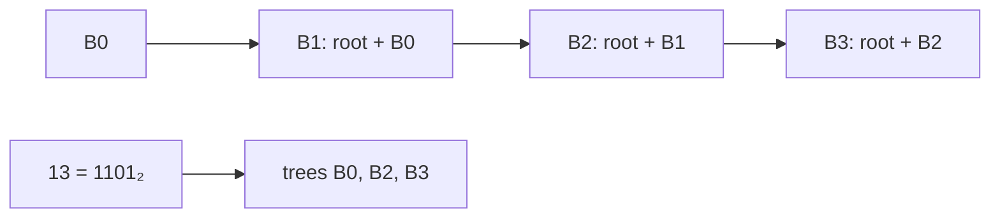

# Binomial Heaps

## What it is
A **binomial heap** is a mergeable priority queue made of **binomial trees**. The binomial tree `B_k` has `2^k` nodes: `B_k` is two copies of `B_{k−1}` with one root made the leftmost child of the other. A heap with `n` nodes contains at most one `B_k` for each bit set in the binary representation of `n`. Binomial heaps appear in the first two editions (Chapter 20/19) and were dropped in the third.

## How it works
* **UNION** merges the two root lists (sorted by degree) and then walks them like **binary addition**: whenever two trees have the same degree, link them (the one with the larger root becomes the leftmost child of the other) — a "carry".
* **INSERT** = union with a one-node heap. **EXTRACT-MIN** removes the smallest root, reverses its child list (which is a valid root list of binomial trees) and unions it back. **DECREASE-KEY** bubbles the node up by exchanging keys with its parents. **DELETE** = decrease to −∞ and extract.

## Complexity
| Operation | Worst case |
|---|---|
| MINIMUM | O(lg n) |
| INSERT, UNION, EXTRACT-MIN, DECREASE-KEY, DELETE | O(lg n) |

(Insert is amortised O(1) by the same argument as the binary counter in [amortized analysis](#/binary_counter).) [Fibonacci heaps](#/fibonacci_heap) improve DECREASE-KEY to amortised O(1).

## When to use it
Mergeable priority queues where union dominates; also a lovely illustration of how number systems (binary addition) shape data-structure design.

## In this implementation
Arena nodes use the left-child / right-sibling representation. `union` appends the other arena and returns the handle offset. Tests assert that the root list always mirrors the binary representation of `n`.
