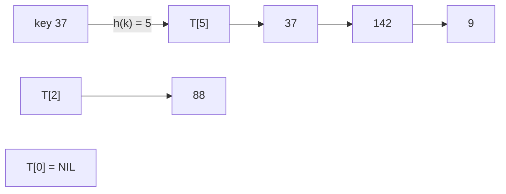

# Hash Tables with Chaining

## What it is
A **hash table** stores `n` keys from a huge universe in `m` slots using a hash function `h: U → {0,…,m−1}`. Two keys can map to the same slot (a **collision**); with **chaining**, every slot holds a linked list of the keys that hashed there.

## How it works
* `INSERT` places the new element at the head of list `T[h(k)]` — Θ(1).
* `SEARCH` scans the list `T[h(k)]`.
* `DELETE` unlinks the element (O(1) with doubly linked lists).

With **simple uniform hashing** and load factor `α = n/m`, an unsuccessful search examines `Θ(1 + α)` elements on average and so does a successful one (Theorems 11.1/11.2). Choosing `m = Θ(n)` gives O(1) expected operations.

## Complexity
Expected Θ(1 + α) search; Θ(1) insert; worst case Θ(n) if all keys collide. Space Θ(n + m).

## When to use it
General-purpose dictionaries (symbol tables, caches, sets) where no ordering is needed. [Universal hashing](#/hash_functions) defeats adversarial inputs; [open addressing](#/open_addressing) avoids pointers; [perfect hashing](#/perfect_hashing) gives worst-case O(1) for static sets.

## In this implementation
A multiplicative mixer feeds a modular reduction; the demo prints chain-length statistics for several load factors, and a randomised test compares behaviour with `std::collections::HashMap`.
