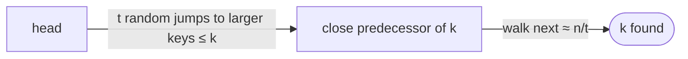

# Searching a Sorted Compact List

## What it is
A **compact list** stores a sorted linked list in arrays `key[]` and `next[]` (as in [implementing pointers and objects](#/array_pointers_objects)), with the nodes in *arbitrary physical order* in the arrays. Binary search is impossible (we cannot jump to the middle of the *list*), so a plain search costs `Θ(n)`. Problem 10-3 shows that **randomisation** gives a sorted-list search with only `O(√n)` expected probes — without any extra storage.

## How it works
`COMPACT-LIST-SEARCH′(L, k, t)`:
1. Start at the head `i`.
2. Repeat `t` times: pick a **random array slot** `j`; if `key[i] < key[j] ≤ k`, jump `i ← j` (we skip ahead in list order for free because `j` is a node of the list).
3. Finish with an ordinary walk from `i` following `next` until a key `≥ k`.

The `t` random samples cut the list into pieces; the best sample found sits within `≈ n/t` list positions of the target, so the walk takes `≈ n/t` steps. Expected total `O(t + n/t)`; with `t = √n` this is **`O(√n)`**.

## Complexity
Deterministic scan `Θ(n)`; randomised `O(t + n/t)` expected, `O(√n)` for `t = √n`; with a worst-case input no deterministic algorithm can beat `Ω(n)` in this model.

## When to use it
A neat illustration of how random sampling speeds up structures with sequential access (skip lists use the same intuition to reach `O(lg n)`).

## In this implementation
`CompactList::from_sorted` scatters nodes in a random permutation. Tests verify correctness for every query on small lists and that 40 000-element searches use under 900 probes with `t = 200` versus ~20 000 for the linear walk.
