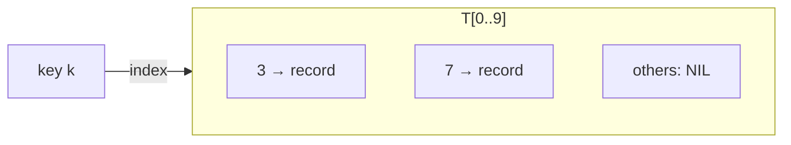

# Direct-Address Tables & Bit Vectors

## What it is
When keys are drawn from a small universe `U = {0, 1, …, m−1}` (and are distinct) we can store the dynamic set in an array `T[0..m−1]` with the key itself as the index. This is a **direct-address table**; it is the starting point from which [hash tables](#/chained_hash_table) are derived.

## How it works
* `SEARCH(T, k)` returns `T[k]`; `INSERT(T, x)` sets `T[x.key] = x`; `DELETE(T, x)` sets `T[x.key] = NIL`.
* Exercise 11.1-2 shrinks the satellite-less version to a **bit vector** of `m` bits: bit `k` is 1 iff `k` is in the set. Maximum is found by scanning words from the top.

## Complexity
All dictionary operations are Θ(1) worst case. Space is Θ(|U|) — impractical if the universe is large (e.g. all 64-bit integers).

## When to use it
Small bounded universes: byte values, ASCII characters, small IDs, bitmap indexes, presence flags. For sparse universes use [hashing](#/hash_functions); for ordered successor queries on integer universes see [van Emde Boas trees](#/van_emde_boas_tree).

## In this implementation
`DirectAddressTable<V>` stores `Option<V>` per slot; `BitVectorSet` packs 64 keys per word and is checked against `BTreeSet` under random operations.
