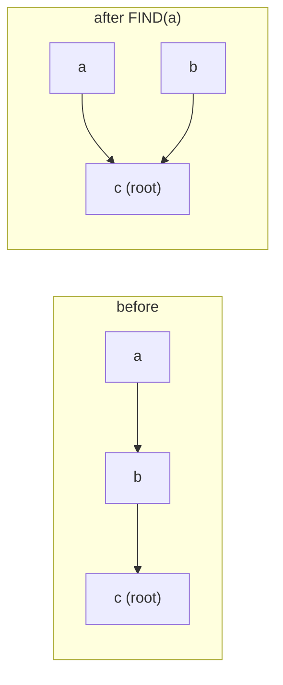

# Disjoint-Set Union (Union-Find)

## What it is
A **disjoint-set data structure** maintains a collection of disjoint dynamic sets and supports `MAKE-SET(x)`, `FIND-SET(x)` (returns the set's *representative*) and `UNION(x, y)`. It underlies [Kruskal's MST algorithm](#/mst_kruskal) and connected-components computations.

## How it works
Two representations are analysed:
* **Linked lists** — each set is a list whose head is the representative, every element points to it. `UNION` appends the *shorter* list to the longer one (**weighted-union heuristic**); each element's pointer is then updated at most `lg n` times, so `m` operations on `n` elements cost `O(m + n lg n)`.
* **Disjoint-set forests** — each set is a rooted tree and the root is the representative. Two heuristics make it nearly constant:
  * **union by rank** attaches the shallower tree under the deeper one;
  * **path compression** makes every node on a `FIND` path point directly at the root.

## Complexity
Forest with both heuristics: `O(m α(n))` for `m` operations, where `α` is the inverse Ackermann function (`α(n) ≤ 4` for every conceivable `n`). Tarjan showed this is tight.

## When to use it
Connected components, [Kruskal](#/mst_kruskal), cycle detection, image segmentation, percolation, equivalence-class merging in compilers (unification), offline least-common-ancestors.

## In this implementation
`DisjointSetForest` (rank + compression), `LinkedListSets` (counts pointer updates to demonstrate the `n lg n` bound) and `connected_components`. Randomised tests compare with naive relabelling.
