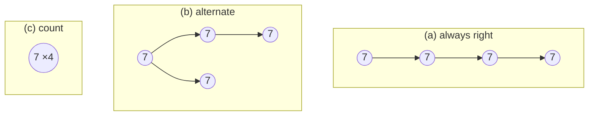

# Binary Search Trees with Equal Keys

## What it is
The textbook [binary search tree](#/binary_search_tree) assumes distinct keys. What if a key can occur many times? Problem 12-1 compares four insertion policies for a key `z` equal to the key of the node `x` being examined, and asks for the cost of inserting `n` **identical** items.

## How it works
1. **Always go right** (`TREE-INSERT` with `≤`): the tree degenerates into a right-going chain; inserting `n` identical keys costs `Θ(n²)`.
2. **Alternate** left and right using a boolean flag stored at each node: the copies spread evenly, giving a perfectly balanced tree of equal keys and `Θ(n lg n)` total work.
3. **Keep a list/count at the node**: the first copy is a node; later copies are appended in `O(1)` after reaching it: `Θ(n)` total, and searching for the key stays logarithmic in the number of *distinct* keys. The best choice when duplicates are common.
4. **Choose left or right randomly**: also `Θ(n lg n)` expected (it behaves like a randomly built tree of identical keys).

In every policy the in-order sequence remains sorted, because equal keys may legally sit on either side.

## Complexity
Total cost of `n` equal keys: (a) `Θ(n²)`, (b) `Θ(n lg n)`, (c) `Θ(n)`, (d) `Θ(n lg n)` expected.

## When to use it
Any ordered multiset (database indexes with non-unique keys, sorted event logs); `std::collections::BTreeMap<K, Vec<V>>` is policy (c).

## In this implementation
An arena-based unbalanced BST with a strategy enum; `insert` returns the number of nodes visited. Tests assert the exact costs for (a) and (c), the bounds for (b) and (d), and that all four keep the in-order traversal sorted and complete.
