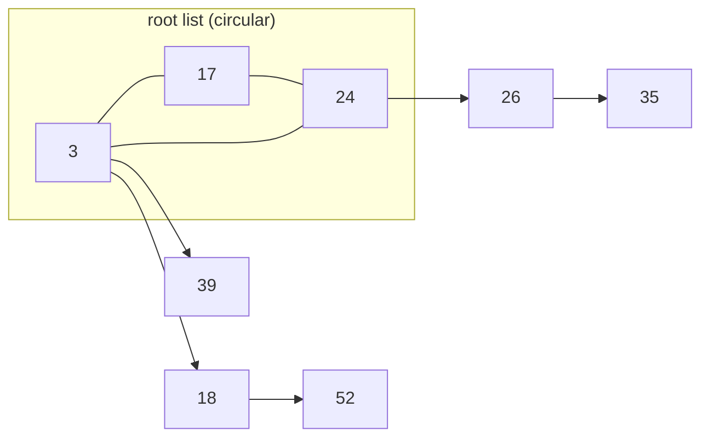

# Fibonacci Heaps

## What it is
A **Fibonacci heap** is a collection of heap-ordered trees designed so that `INSERT`, `MINIMUM`, `UNION` and `DECREASE-KEY` take only **amortised O(1)** time, while `EXTRACT-MIN` and `DELETE` take amortised O(lg n). It was the key to speeding up [Dijkstra](#/dijkstra) and [Prim](#/mst_prim) to `O(E + V lg V)`. The 4th edition removed the chapter ("rarely taught"), but 1st–3rd editions include it.

## How it works
* Roots live in a circular doubly linked **root list** with a pointer to the minimum. `INSERT` and `UNION` are *lazy*: just splice into the root list.
* `EXTRACT-MIN` removes the minimum, promotes its children to roots, then **consolidates**: link roots of equal degree (the larger key becomes a child) until all root degrees are distinct (≤ `⌊log_φ n⌋`).
* `DECREASE-KEY` lowers a key; if it now violates heap order with its parent, **cut** it and move it to the root list. A node that has lost a child is *marked*; losing a second child triggers a **cascading cut**.

The potential function `Φ = t(H) + 2·m(H)` (root trees + 2·marked nodes) yields the amortised bounds. Marking guarantees a node of degree `k` has at least `F_{k+2}` descendants — the Fibonacci numbers behind the name.

**Problems 19-1 and 19-3.** *Pisano's delete* removes a non-minimum node `x` directly: cut it from its parent (with a cascading cut), move its children to the root list and unlink it — without ever making `x` the minimum, hoping to save the `−∞` decrease and the `EXTRACT-MIN` consolidation. Problem 19-1 asks why the hoped-for speed-up is an illusion: moving `x`'s children to the root list is **not `O(1)`** (it touches all `x.degree` of them), the actual cost is `O(x.degree + c)` for `c` cascading cuts, and the potential bound shows the **amortised cost is asymptotically no better** than that of the book's `FIB-HEAP-DELETE`, even when `x` is not the minimum. *Change-key*: a decrease is `DECREASE-KEY`; an increase is done here by delete + insert (the handle changes). `FIB-HEAP-PRUNE(H, r)` deletes `q = min(r, n)` nodes of our choosing: we take the first `q` nodes of a post-order traversal (so each is a leaf when its turn comes) and delete them with `CUT` + `CASCADING-CUT`, each amortised `O(1)`, then rebuild the minimum pointer. The traversal and the minimum rebuild add work proportional to the nodes visited and to the final root list, so this implementation does not claim the problem's amortised `O(r)` bound in the worst case.

**Problem 19-2(d), (e).** If only the mergeable-heap operations (insert, union, extract-min) are used, every tree produced by consolidation is a **binomial tree**, so the maximum degree is at most `⌊lg n⌋` (checked by a test). In Professor McGee's variant, `INSERT` and `UNION` consolidate the root list as their last step; the root list is then always the binary representation of `n` (also tested), but `INSERT` and `UNION` lose their `O(1)` amortised bound: the consolidation costs `O(lg n)` even when nothing is linked. `consolidate_now()` and `root_count()` expose this.

## Complexity
| Operation | Amortised |
|---|---|
| INSERT, MINIMUM, UNION, DECREASE-KEY | O(1) |
| EXTRACT-MIN, DELETE | O(lg n) |

## When to use it
Theoretically optimal graph algorithms; in practice binary/pairing/4-ary heaps are often faster because of constant factors.

## In this implementation
An arena-based version of the book's pseudocode. `union` appends the other heap's arena (handles shift by the returned offset); tests check heap-sort order, random decrease-key/delete behaviour against a model, and the Fibonacci degree bound. `pisano_delete`, `change_key` and a structural `validate()` are exercised by a 4 000-operation random test against a model, with invariants checked every 50 operations.
