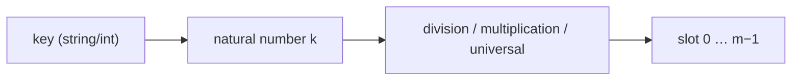

# Hash Functions & Universal Hashing

## What it is
A good hash function distributes keys evenly over the slots and is independent of patterns in the data. Section 11.3 describes three constructions.

## How it works
* **Division method** `h(k) = k mod m`. Pick `m` prime and not near a power of two; `m = 2^p` just keeps the low `p` bits.
* **Multiplication method** `h(k) = ⌊m · (kA mod 1)⌋` with `A ≈ (√5−1)/2 ≈ 0.618`. Works with any `m`, so `m = 2^p` is fine; the word version multiplies by `⌊A·2^w⌋` and keeps the top `p` bits.
* **Universal hashing** — choose the function *at random* from a family so that for any distinct keys `Pr[h(x) = h(y)] ≤ 1/m`. The classic family is `h_ab(k) = ((ak + b) mod p) mod m` with prime `p > |U|`, `a ∈ {1…p−1}`, `b ∈ {0…p−1}`.
* **Strings** are converted to integers in radix 128 and then hashed.

With universal hashing, the expected chain length for **any** fixed set of keys is `1 + α` — an adversary cannot pick a bad set in advance.

## Complexity
O(1) per key for numeric keys; O(length) for strings.

## When to use it
Always when you build a [hash table](#/chained_hash_table), [open-addressing table](#/open_addressing) or [perfect hash](#/perfect_hashing); universal hashing is mandatory for security-sensitive inputs (hash-flooding attacks) and for provable bounds.

## In this implementation
Both multiplication variants, `UniversalHash` (128-bit arithmetic avoids overflow) and a collision counter. A statistical test checks that the observed collision probability is at most ≈ `1/m`.
