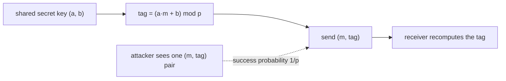

# Hashing and Authentication

## What it is
Alice and Bob share a secret and want to detect tampering with messages sent over an insecure channel. Problem 11-4 shows that [universal hashing](#/hash_functions) is the right tool: they secretly pick a function `h` from a **universal** family `H`; Alice sends `(m, h(m))`; Bob recomputes `h(m)` and accepts only if the tag matches. An attacker who has seen one valid pair `(m, t)` but does not know which `h` was chosen should have a negligible chance of producing another valid pair `(m′, t′)` with `m′ ≠ m`.

## How it works
Plain universality (`Pr[h(m) = h(m′)] ≤ 1/m`) is not quite enough — what matters is the conditional probability of `h(m′) = t′` *given* `h(m) = t`. The family

`h_{a,b}(m) = (a·m + b) mod p`  (`a, b ∈ Z_p`, `p` prime)

is **pairwise independent**: for `m ≠ m′` and any `t, t′` there is **exactly one** key `(a, b)` with `h(m) = t` and `h(m′) = t′` (solve the two linear equations). Hence, after seeing `(m, t)`, exactly `p` keys remain possible and only one forges `(m′, t′)`: **forgery probability `1/p`**. For messages of `k` blocks use the polynomial family `Σ m_i a^i + b`: two distinct messages collide only for the at most `k − 1` roots of their difference polynomial, giving forgery probability about `k/p`. (Real systems such as Poly1305 and GMAC are exactly this construction over a large field, with the one-time key used once per message.)

## Complexity
One multiplication and addition modulo `p` per block; security `1/p` per forgery attempt (information-theoretic — no computational assumption), but each key must be used for only **one** message.

## When to use it
Message authentication codes (Carter–Wegman MACs), integrity checks in network protocols, and any setting where a short secret must protect many messages (derive a fresh key per message with a pseudo-random function).

## In this implementation
Tests enumerate all `p²` keys for `p = 23` and verify pairwise independence exactly (`p` keys consistent with one observation, exactly one forging any other pair) on 100 random message/tag choices, and verify the root-counting bound on collisions of multi-block messages for `p = 31`.
