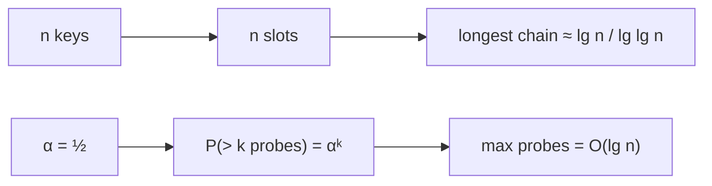

# Hashing Bounds: Longest Chain & Probe Tails

## What it is
The expected cost of hashing is `O(1)`, but what about the *worst* slot or the *unlucky* operation? Problems 11-1 and 11-2 prove high-probability bounds for the two collision-resolution schemes; this module checks them by simulation.

## How it works
* **Chaining (Problem 11-2).** Hash `n` keys into `n` slots uniformly. The probability that a given slot gets `≥ k` keys is at most `C(n,k)(1/n)^k ≤ 1/k!`. Choosing `k = c·lg n / lg lg n` makes this `< 1/n^c`, and a union bound over `n` slots shows the longest chain is **`O(lg n / lg lg n)` with probability ≥ `1 − 1/n`** — and this is tight (`Θ`). So the worst-case lookup of a random hash table is *not* `O(1)` but grows very slowly.
* **Open addressing (Problem 11-1).** With load factor `α = n/m ≤ 1/2` and uniform hashing, the probability that an unsuccessful search needs more than `k` probes is at most `α^k`; hence the longest probe sequence over all `n` insertions is `O(lg n)` w.h.p.

Two-choice hashing ("power of two choices") improves the longest chain to `Θ(lg lg n)`.

## Complexity
Expected `O(1)` per operation; longest chain `Θ(lg n / lg lg n)` w.h.p.; longest probe sequence `O(lg n)` w.h.p.

## When to use it
Sizing hash tables for latency-critical systems (tail latency), justifying the load factor `α ≤ 0.75`, and as examples of the first-moment/union-bound technique ([balls and bins](#/probabilistic_analysis)). See [chaining](#/chained_hash_table) and [open addressing](#/open_addressing).

## In this implementation
Monte-Carlo experiments with the deterministic RNG: the longest-chain average stays between `lg n / lg lg n` and `3.5×` it for `n = 2⁸ … 2¹⁵`, and the probe tail matches `αᵏ` within 2 percentage points.
