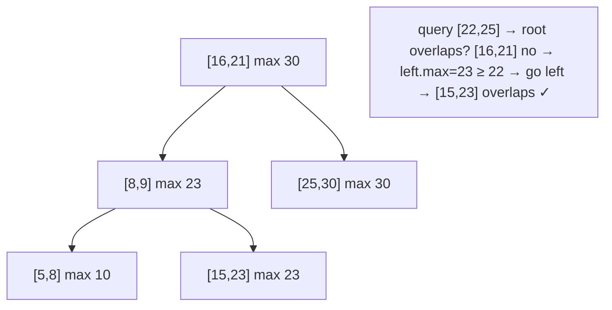

# Interval Trees

## What it is
An **interval tree** stores closed intervals `[low, high]` and quickly answers "does any stored interval overlap the query interval `i`?" It is the second augmentation example of Chapter 14 (after [order-statistic trees](#/order_statistic_tree)).

## How it works
Use a [red-black tree](#/red_black_tree) keyed by the **low** endpoint, and let each node store `x.max`, the largest high endpoint in its subtree: `x.max = max(x.high, x.left.max, x.right.max)`.

`INTERVAL-SEARCH(T, i)`:
```
x = root
while x ≠ nil and i does not overlap x.int:
    if x.left ≠ nil and x.left.max ≥ i.low: x = x.left
    else: x = x.right
```
**Why it is correct:** if the search goes left, either the left subtree contains an overlapping interval, or none does *and* neither does the right subtree (every interval on the left ends before `i.low`... or begins after `i.high`, contradicting the BST order). If it goes right, `x.left.max < i.low`, so nothing on the left can overlap.



## Complexity
Insert, delete, single search: O(lg n). Listing all `k` overlapping intervals: O(min(n, k lg n)).

## When to use it
Calendar conflict detection, genomics (overlapping features), computational geometry (windowing queries), and scheduling.

## In this implementation
`IntervalTree` wraps the augmented `RedBlackTree` (key = low, aux = high). The tests compare against a brute-force scan after each random insert/delete and re-validate the red-black and `max` invariants.
