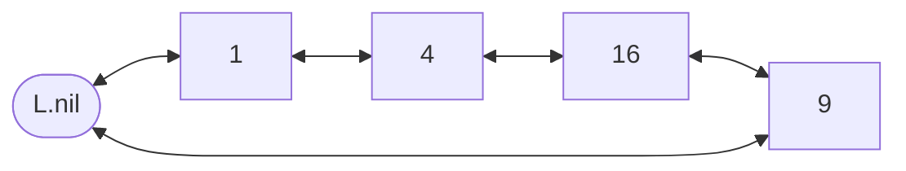

# Linked Lists

## What it is
A **linked list** keeps its elements in linear order using *pointers* rather than array indices. CLRS presents the general case — a *doubly linked, circular list with a sentinel* — because the sentinel `L.nil` removes every boundary check from `LIST-DELETE`.

## How it works
Each node has `key`, `prev` and `next`. The sentinel sits between the tail and the head, so `L.nil.next` is the head and `L.nil.prev` is the tail.

* `LIST-SEARCH` walks `next` until the key is found or it returns to `nil` — Θ(n).
* `LIST-INSERT` splices at the front — Θ(1).
* `LIST-DELETE(x)` redirects the neighbours' pointers — Θ(1) given `x`.

Exercise 10.2-7 reverses a singly linked list in place by flipping each `next` pointer while walking down the list.

## Complexity
| Operation | Time |
|---|---|
| Insert at head | Θ(1) |
| Delete given node | Θ(1) |
| Search | Θ(n) |

## When to use it
Frequent insertions/deletions at known positions, LRU caches, adjacency lists for [graphs](#/breadth_first_search), chaining in [hash tables](#/chained_hash_table). Poor cache locality makes arrays preferable for scanning.

## In this implementation
The sentinel list lives in an index-based arena (the safe-Rust way to get pointer semantics; see [Implementing pointers and objects](#/array_pointers_objects) for the book's own array version). The singly list uses `Option<Box<Node>>`.
