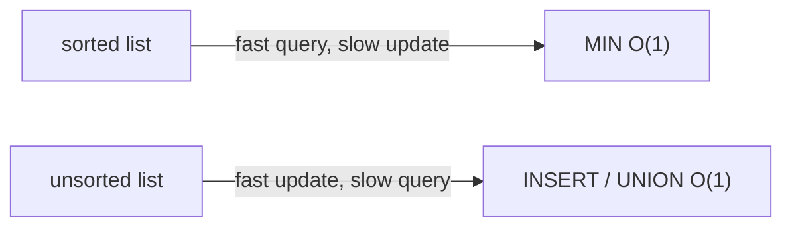

# Mergeable Heaps with Linked Lists

## What it is
A **mergeable heap** supports `MAKE-HEAP`, `INSERT`, `MINIMUM`, `EXTRACT-MIN` and `UNION`. Problem 10-2 asks you to implement it with *linked lists* and compare the costs — a warm-up for the sophisticated structures later in the book.

## How it works
| Representation | INSERT | MINIMUM | EXTRACT-MIN | UNION |
|---|---|---|---|---|
| (a) **sorted** list | `O(n)` | `O(1)` | `O(1)` | `O(n)` (merge) |
| (b) **unsorted** list | `O(1)` | `O(n)` | `O(n)` | `O(1)` (concatenate) |
| (c) sorted lists of the original **disjoint** sets | — | — | — | amortised via merging smaller into larger |

Neither list gives logarithmic time for everything. The later chapters achieve `O(lg n)` for all five operations with [binomial heaps](#/binomial_heap), and amortised `O(1)` `UNION`/`INSERT` with [Fibonacci heaps](#/fibonacci_heap) and [pairing heaps](#/pairing_heap).

## Complexity
See the table; the implementation counts list-node steps so the trade-off is visible.

## When to use it
Tiny heaps or workloads dominated by one operation type. Otherwise a [binary heap](#/heap_priority_queue) (no `UNION`) or one of the mergeable structures above.

## In this implementation
`SortedListHeap` and `UnsortedListHeap` expose a `steps` counter; tests check that both behave like a priority queue and that unsorted `UNION` costs a single step.
