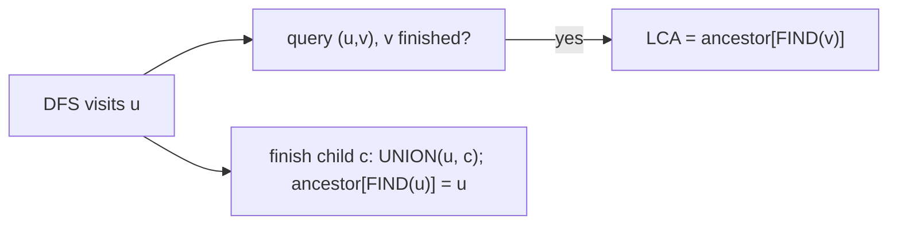

# Disjoint-Set Applications: Off-line Minimum, Depth, Tarjan's LCA

## What it is
Three problems at the end of the disjoint-set chapter show how union-find ([forests with rank and path compression](#/disjoint_set)) solves problems that look unrelated to equivalence classes. All run in nearly linear time `O(m α(n))`.

## How it works
**Off-line minimum (Problem 21-1).** A sequence of `INSERT(i)` (each of `1…n` once) and `EXTRACT-MIN` operations is given in advance; output which key each extraction returns. Group the keys into sets `K_j` = keys inserted before the `j`-th extraction. Process `i = 1, 2, …, n`: find the set `K_j` holding `i`; if `j` is a real extraction, `i` is that extraction's answer — then merge `K_j` into the next surviving set `K_l` (`l > j`), since `i` is gone.

**Depth determination (Problem 21-2).** Maintain a forest with `FIND-DEPTH(v)` and `GRAFT(r, v)`. Store with every node an *offset* `d`, so that `depth(x)` is the sum of offsets on the path to the union-find root; grafting a whole tree shifts all its depths by `depth(v) + 1`, which is **one** offset update on the tree's representative, and path compression preserves partial sums (a *weighted union-find*).

**Tarjan's off-line LCA (Problem 21-3).** Do a [depth-first walk](#/depth_first_search) of the tree. When a vertex `u` finishes, `UNION` it into its parent's set and record the parent as the set's *ancestor*. For a query `(u, v)`, when the walk reaches `u` and `v` is already finished, `LCA(u,v)` = the `ancestor` stored for `v`'s set.

## Complexity
`O((n + m) α(n))` for each problem.

## When to use it
Batch processing of queries known up front: LCA for tree statistics, event simulations with priority queues replaced by sorted processing, dynamic tree depths in union-find based graph algorithms.

## In this implementation
Union-find is implemented inline (path compression). Each application is cross-checked with a naive simulation on hundreds of random instances — heap simulation for off-line minimum, parent-pointer arrays for depths, and ancestor-list intersection for LCA.
