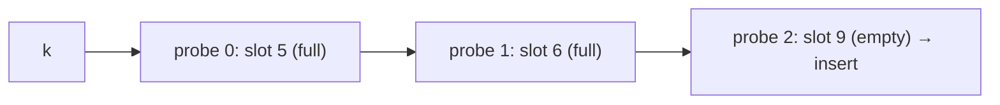

# Open Addressing

## What it is
In **open addressing** every element lives in the table itself (no linked lists). A collision is resolved by *probing*: examining a sequence of slots `h(k,0), h(k,1), …` until an empty one is found. The load factor can never exceed 1.

## How it works
| Strategy | Probe sequence `h(k, i)` | Notes |
|---|---|---|
| Linear | `(h'(k) + i) mod m` | simple; suffers **primary clustering** |
| Quadratic | `(h'(k) + c₁i + c₂i²) mod m` | milder **secondary clustering**; with `m = 2^p` and `c₁=c₂=½` visits all slots |
| Double hashing | `(h₁(k) + i·h₂(k)) mod m` | `h₂(k)` relatively prime to `m`; best, ≈ uniform hashing |

Deletion cannot simply empty a slot (that would break the probe chain of later keys), so the slot is marked **DELETED**; `INSERT` may reuse it, `SEARCH` skips over it.

Under uniform hashing an unsuccessful search needs at most `1/(1−α)` probes on average and a successful one `(1/α) ln(1/(1−α))`.

## Complexity
Expected O(1) for constant `α < 1`; Θ(n) worst case. Space Θ(m) with no pointers — good cache behaviour (linear probing is fastest in practice, and the 4th edition analyses it using 5-independent hashing).

## When to use it
Memory-tight or cache-sensitive dictionaries (symbol tables in compilers, hash sets in runtimes). Keep `α ≲ 0.75`.

## In this implementation
`OpenAddressTable` with three probe strategies on a power-of-two table; the tests verify set semantics under random insert/delete/search and that a table can be filled to 100%.
