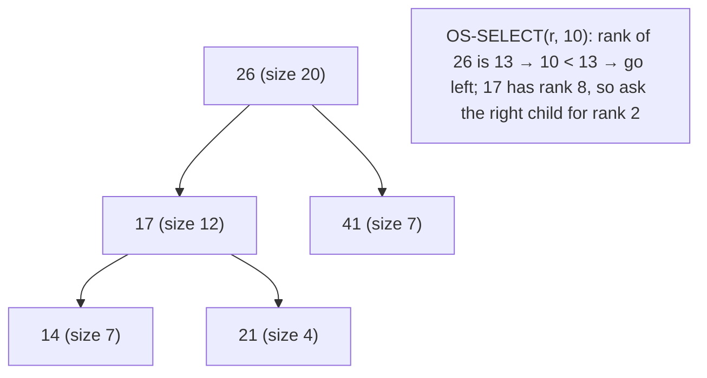

# Order-Statistic Trees

## What it is
Chapter 14 shows how to **augment** a data structure. An *order-statistic tree* is a [red-black tree](#/red_black_tree) in which each node `x` also stores `x.size`, the number of nodes in its subtree. That one extra field supports "find the i-th smallest" and "what is the rank of this key?" in O(lg n), instead of the Θ(n) a plain BST needs.

## How it works
`x.size = x.left.size + x.right.size + 1`.

* `OS-SELECT(x, i)` — let `r = x.left.size + 1` be `x`'s rank in its own subtree; return `x` if `i = r`, recurse left if `i < r`, otherwise recurse right for rank `i − r`.
* `OS-RANK(T, x)` — start with `r = x.left.size + 1`, then walk up; each time we come from a right child add `parent.left.size + 1`.
* **Maintaining `size`**: insertion/deletion adjust sizes along the root path (O(lg n)); each rotation fixes the two affected nodes in O(1). This is the general recipe (Theorem 14.1): an attribute that depends only on a node and its children can be maintained without changing the asymptotic cost.

## Complexity
SELECT, RANK, INSERT, DELETE: Θ(lg n).

## When to use it
Rank/percentile queries on changing data, counting inversions (Exercise 14.1-7), "k-th element" in a sliding window, or finding the Josephus-permutation survivor.

## In this implementation
`OsTree` is a thin wrapper over the size-augmented `RedBlackTree`; `count_inversions` implements Exercise 14.1-7 and is checked against the merge-sort counter.
