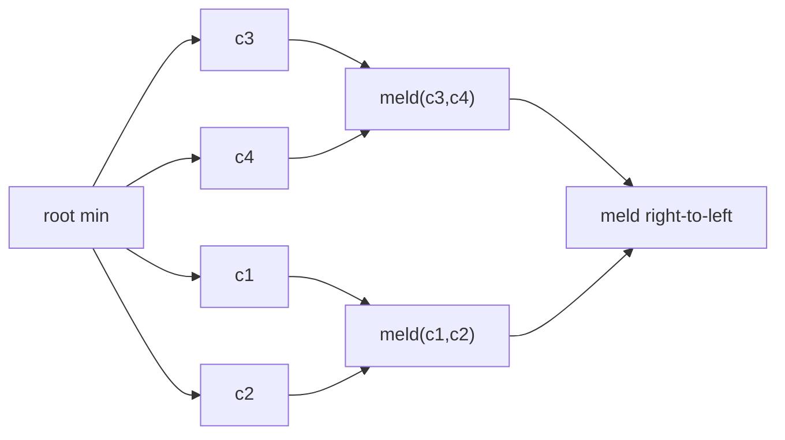

# Pairing Heaps

## What it is
A **pairing heap** (Fredman, Sedgewick, Sleator & Tarjan, 1986) is a heap-ordered multiway tree with a very simple implementation that is nevertheless one of the fastest priority queues in practice. Problem 19-2 of the 3rd edition asks you to analyse it; it is meant as a simpler alternative to [Fibonacci heaps](#/fibonacci_heap).

## How it works
Each node keeps a first child and a next sibling (left-child right-sibling form, cf. [rooted trees](#/rooted_trees)).
* `MELD(a, b)`: the root with the larger key becomes the **first child** of the other: `O(1)`. So `INSERT` and `UNION` are `O(1)`.
* `EXTRACT-MIN`: remove the root; its children are combined by the **two-pass heuristic**: pair them up left to right (meld each adjacent pair), then meld the results right to left into one tree.
* `DECREASE-KEY(x, k)`: lower the key; if `x` is not the root, **cut** its subtree out of the parent's child list and meld it with the root.

Known bounds: `EXTRACT-MIN` is `O(lg n)` amortised and `INSERT`/`MELD` are `O(1)`; DECREASE-KEY is `O(2^{2√(lg lg n)})` (Pettie) and `Ω(lg lg n)` (Fredman) — not the `O(1)` of Fibonacci heaps, but the constant factors are far smaller.

## Complexity
Insert, meld: `O(1)`; extract-min: `O(lg n)` amortised; decrease-key: `o(lg n)` amortised.

## When to use it
A practical alternative to [binary heaps](#/heap_priority_queue) in [Dijkstra](#/dijkstra) and [Prim](#/mst_prim), and a frequent choice in functional languages. The exact decrease-key cost remained an open problem for decades.

## In this implementation
Arena nodes with a `prev` pointer (parent for first children, left sibling otherwise) so a node can be cut in `O(1)`; tests check heapsort order, `union`, and 3000 random insert/extract/decrease-key operations against a model.
