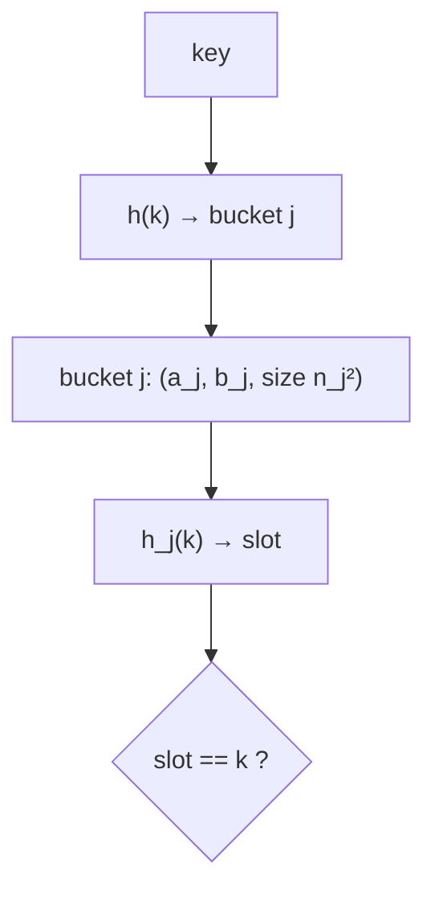

# Perfect Hashing (FKS)

## What it is
Chained and open-addressing tables give expected O(1) lookups. If the key set is **static** (e.g. the reserved words of a language) we can do better: **worst-case O(1)** lookups with O(n) space. The construction of Fredman, Komlós and Szemerédi is Section 11.5 of the 2nd and 3rd editions (removed in the 4th).

## How it works
Two levels of hashing, both chosen from a universal family:
1. Hash the `n` keys into `m = n` buckets with `h`. Retry until `Σ nⱼ² < 4n` (Markov's inequality: succeeds with probability ≥ ½ because `E[Σ nⱼ²] < 2n`).
2. Bucket `j` with `nⱼ` keys gets a **secondary table of size `nⱼ²`** and its own hash `hⱼ`. With `nⱼ²` slots the probability of any collision among `nⱼ` keys is `< ½`, so a few random tries find a collision-free `hⱼ`.

## Complexity
Lookup: Θ(1) worst case (two hash evaluations + one comparison). Space: expected Θ(n) (this code asserts ≤ 5n). Construction: expected O(n).

## When to use it
Read-only dictionaries: compiler keyword tables, routing tables, static spell-check sets, lookup tables in firmware. Dynamic variants exist (cuckoo hashing, dynamic FKS).

## In this implementation
The prime is the Mersenne number 2⁶¹−1, so keys up to 2⁶⁰ hash correctly; `PerfectHash::build` retries both levels with the project RNG and exposes `top_level_retries` and `total_slots`.
