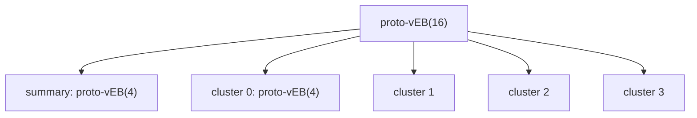

# Proto van Emde Boas Structure

## What it is
Section 20.2 of the 3rd edition builds the [van Emde Boas tree](#/van_emde_boas_tree) in stages. The **proto-vEB structure** is the first stage: a recursive structure over the universe `{0, …, u−1}` with `u = 2^(2^k)` (so that `√u` is again of that form) that supports MEMBER, INSERT, DELETE, MINIMUM, MAXIMUM, SUCCESSOR and PREDECESSOR.

## How it works
* `u = 2`: just an array of two bits.
* `u > 2`: a **summary** proto-vEB(√u) whose bit `i` says whether cluster `i` is non-empty, and an array of `√u` **clusters**, each a proto-vEB(√u). A key `x` splits into `high(x) = ⌊x/√u⌋` (cluster number) and `low(x) = x mod √u` (position inside).
* `MEMBER`/`INSERT` recurse into **one** cluster (and insert also touches the summary): `T(u) = 2T(√u) + Θ(1) = Θ(lg u)`.
* `SUCCESSOR(x)`: look inside `x`'s cluster; if nothing larger, ask the **summary** for the next non-empty cluster and take its minimum. That needs *three* recursive calls (cluster, summary, minimum of the target cluster), so `T(u) = 3T(√u) + Θ(1) = Θ(lg u · lg 3 …) = Θ(lg^{1.58} u)`; `MINIMUM` similarly costs `2T(√u)`.
The full vEB tree fixes this by **storing the minimum and maximum explicitly** (and not in the clusters), reducing every operation to a single non-trivial recursive call: `O(lg lg u)`.

## Complexity
Space `Θ(u)`. MEMBER/INSERT `Θ(lg u)`; MIN/MAX/SUCCESSOR/PREDECESSOR/DELETE with the recursive structure above `Θ(lg^{log₂3} u)`-type bounds — worse than the final vEB tree, which is the point of the section.

## When to use it
As a teaching stepping stone: it explains why the min/max trick is necessary. For real use choose the full [vEB tree](#/van_emde_boas_tree) or a [direct-address table](#/direct_address_table) when `u` is small.

## In this implementation
Universes must be `2^(2^k)` (2, 4, 16, 256, …) as in the book; randomised tests compare every operation with `BTreeSet`.
