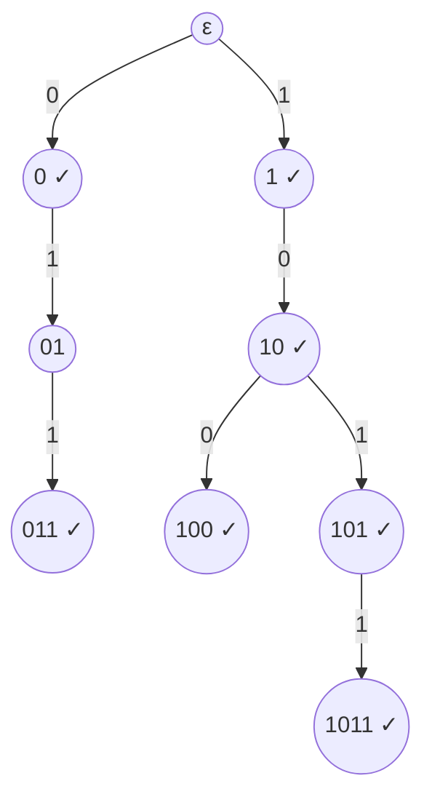

# Radix Trees

## What it is
A **radix tree** (binary trie) stores strings of bits by their *path*: the edge taken at depth `i` is the `i`-th bit, and a node is marked when a stored string ends there. Problem 12-2 introduces it as an alternative to a [binary search tree](#/binary_search_tree) for storing bit strings and asks you to sort a set of strings with it.

## How it works
* **Insert / search** walk one edge per bit: `Θ(|s|)` regardless of how many strings are stored — no string comparisons at all.
* **Sorting**: a **preorder** traversal that visits a marked node before its children, and the 0-child before the 1-child, lists the strings in lexicographic order (a proper prefix sorts before its extensions). All distinct strings are sorted in time `Θ(Σ|sᵢ|)`, linear in the total length — contrast the `Θ(n lg n)` comparisons of a comparison sort, whose cost per comparison is up to `Θ(len)`.

## Complexity
Each operation `O(|s|)`; space `O(Σ|sᵢ|)` nodes in the worst case (shared prefixes reduce it).

## When to use it
IP routing tables (longest-prefix match), dictionaries/auto-complete, spell checkers, and as the idea behind [radix sort](#/radix_sort) on strings and suffix trees ([suffix arrays](#/suffix_array)). Compressed variants (Patricia / radix trees with edge labels) cut the node count to `O(n)`.

## In this implementation
Arena nodes with two optional children; tests compare `sorted()` with `slice::sort` + `dedup` on 100 random string sets, and check that proper prefixes are not members unless inserted.
