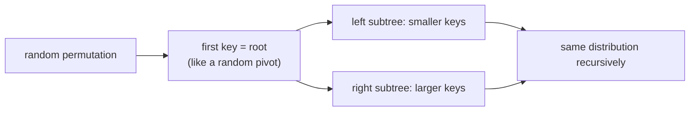

# Randomly Built Binary Search Trees

## What it is
The worst-case height of a [binary search tree](#/binary_search_tree) is `n − 1`, yet in practice trees built from *random* insertion orders are very shallow. Section 12.4 (1st–3rd editions; removed in the 4th) proves that a **randomly built BST** — one obtained by inserting the keys in a uniformly random order — has expected height `O(lg n)`.

## How it works
The proof is a beautiful link to [quicksort](#/randomized_quicksort): the first key inserted is the root, exactly as a pivot splits an array; a random permutation makes the root rank uniform in `1…n`. Define the *exponential height* `Yₙ = 2^{Xₙ}`; Jensen's inequality plus the recurrence

`E[Yₙ] = (4/n) Σ_{i<n} E[Yᵢ]`

gives `E[Yₙ] = ¼·C(n+3, 3)`, so `E[Xₙ] ≤ 3 lg n + O(1)`. The true constant (Reed, 2003) is `4.311 ln n − 1.953 ln ln n ≈ 2.99 lg n`, and the **average node depth** is `2(1 + 1/n)Hₙ − 4 ≈ 2 ln n`.

## Complexity
Expected height Θ(lg n); search, insert and delete are therefore expected Θ(lg n) *if the insertions are random* — an assumption that deletions can break, which is why guaranteed balancing schemes exist.

## When to use it
As analysis rather than a data structure; it justifies using plain BSTs for shuffled data and underlies [treaps](#/treap), which make the randomness part of the structure.

## In this implementation
`simulate` builds random trees, measuring height and average depth, and compares them with the closed forms; the demo contrasts sorted insertion (height 199).
