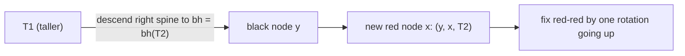

# Persistent Red-Black Trees: JOIN and SPLIT

## What it is
Two problems of Chapter 13 extend [red-black trees](#/red_black_tree):
* **Problem 13-1 (persistent dynamic sets):** keep *all* past versions of a set available. Instead of copying the tree on each update, copy only the nodes on the root-to-change path — `O(lg n)` new nodes — and share everything else.
* **Problem 13-2 (join operation):** `RB-JOIN(T₁, x, T₂)` takes two red-black trees with `keys(T₁) < x.key < keys(T₂)` and returns one red-black tree of all the keys in `O(lg n)` time; `SPLIT` is its inverse.

## How it works
Store **black-heights** `bh` in the nodes (this is the extra attribute of Problem 13-2).
* **JOIN:** if the black-heights are equal, make `x` the root. Otherwise (say `bh(T₁) > bh(T₂)`), descend the **right spine of `T₁`** to a *black* node `y` with `bh(y) = bh(T₂)`, replace `y` by a **red** node with children `y` and `T₂`, and key `x`. A red-red violation can appear along the spine and is repaired by the standard rotation `black(l, k, red(a, q, red(b, r, c))) → red(black(l, k, a), q, black(b, r, c))`; the descent costs `O(|bh(T₁) − bh(T₂)|)`.
* **SPLIT(T, k):** walk down to `k`; every subtree hanging off the search path is joined back with the path's keys: left parts accumulate into `T_<`, right parts into `T_>`. The costs telescope to `O(lg n)` (black-height differences along the path add up to at most the height).
* **Persistence:** all nodes are immutable and reference-counted (`Rc`); an update returns a new root while the old one remains valid.
* Insert/delete come for free: `insert = split + join`, `delete = split + join2`.

## Complexity
JOIN `O(lg n)`, SPLIT `O(lg n)`; persistent insert/delete `O(lg n)` time and extra space.

## When to use it
Ordered-set libraries with *union/intersection/difference* (join-based algorithms of Blelloch et al.), functional programming (persistent maps), undo histories and database snapshots. See also [treaps](#/treap) and [AVL trees](#/avl_tree), which also support join/split.

## In this implementation
A functional red-black tree (`Rc<Node>`) following the join-based approach; tests validate the red-black invariants after every operation, check split/join round trips, joins of wildly different heights, and that previous versions are unchanged.
