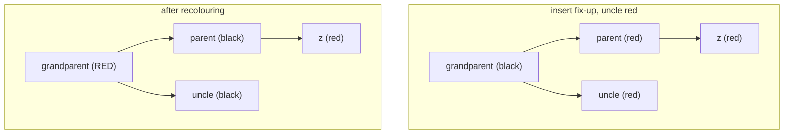

# Red-Black Trees

## What it is
A **red-black tree** is a binary search tree in which every node carries one extra bit — its colour — chosen so that no root-to-leaf path is more than twice as long as any other. The tree is therefore *approximately balanced* and all dictionary operations take `O(lg n)` worst case.

## How it works
Five properties (Chapter 13):
1. Every node is red or black.
2. The root is black.
3. Every leaf (`NIL`) is black.
4. A red node has two black children.
5. All simple paths from a node to descendant leaves have the same number of black nodes (its **black-height**).

These imply `height ≤ 2 lg(n+1)`.

* **Rotations** (`LEFT-ROTATE`, `RIGHT-ROTATE`) change local pointer structure in O(1) and preserve BST order.
* **RB-INSERT** adds a red leaf and calls `RB-INSERT-FIXUP`: if the uncle is red, recolour (case 1) and move up; otherwise 1–2 rotations finish (cases 2–3).
* **RB-DELETE** splices out a node (as in [BST delete](#/binary_search_tree)) and, if a black node vanished, `RB-DELETE-FIXUP` repairs the "double black" with at most 3 rotations (cases 1–4).

## Complexity
Search, insert, delete, min, max, successor: Θ(lg n) worst case; insert uses ≤ 2 rotations and delete ≤ 3.

## When to use it
Default ordered map/set in many standard libraries (C++ `std::map`, Java `TreeMap`), the Linux kernel's `rbtree`, and as the base for [order-statistic](#/order_statistic_tree) and [interval](#/interval_tree) trees.

## In this implementation
A direct port of the book's pseudocode with the shared sentinel at arena index 0. Each node additionally stores `size` and `max(aux)` and maintains them through rotations/insert/delete, so Chapter 14's augmentations reuse this file. `validate()` checks all red-black properties and the augmentations; tests call it after random operations.
