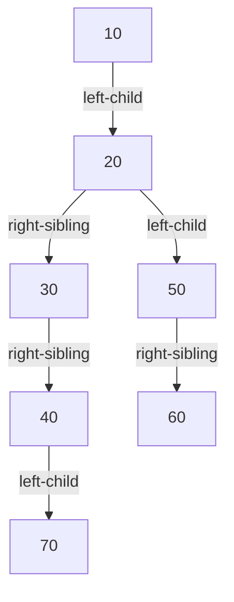

# Representing Rooted Trees

## What it is
A binary tree needs only `left` and `right` pointers, but a general **rooted tree** may have unbounded branching, so storing a child array in every node wastes space. The **left-child, right-sibling** representation uses exactly two pointers per node for any number of children, and the space is `O(n)`.

## How it works
Each node `x` stores `x.left-child` (its leftmost child) and `x.right-sibling` (the next child of the same parent). To visit all children, follow `left-child` once and then `right-sibling` repeatedly.

Exercises 10.4-2…5 develop traversals:
* recursive print of all keys;
* the same with an explicit **stack** (no recursion);
* an **O(1)-extra-space** inorder walk of a binary tree with parent pointers, tracking where we came from (`prev`) to decide whether to go left, right or up.

## Complexity
Traversals are Θ(n). The constant-space walk trades the stack for extra pointer comparisons but never exceeds 3 visits per node.

## When to use it
File-system/DOM-like trees with many children, parse trees, and the "first-child/next-sibling" trick in [binomial heaps](#/binomial_heap) and [Fibonacci heaps](#/fibonacci_heap).

## In this implementation
`RootedTree` is built from child lists; `BinTree` keeps parent pointers for the iterative inorder walk, which is tested against the recursive one on random trees.
