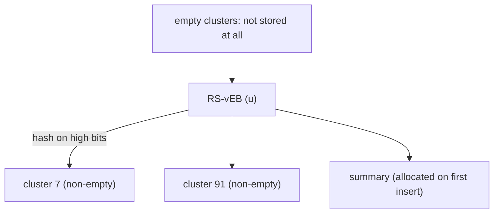

# Reduced-Space van Emde Boas Trees

## What it is
The [van Emde Boas tree](#/van_emde_boas_tree) supports INSERT, DELETE, MEMBER, SUCCESSOR and PREDECESSOR on a universe of size `u` in `O(lg lg u)` time, but it pre-allocates a summary and `√u` clusters at every level, so it needs **`Θ(u)` space** even when it stores a handful of keys. Problem 20-1 asks you (a–b) to analyse that space and (c–g) to design the **reduced-space (RS) vEB tree**, whose space depends on the number `n` of stored keys.

## How it works
* **Space of the plain tree.** `P(u) = (√u + 1)·P(√u) + Θ(√u)`: one summary and `√u` clusters, each of universe `√u`. For `u = 2^(2^k)` and constant 1 this solves to `P(u) = 2u − 3 = O(u)` (the demo prints the values), because the recursion tree has `u` leaves and the `√u` overhead telescopes.
* **RS-vEB tree.** Store the clusters in a **hash table** that holds only *non-empty* clusters, and allocate the summary only when the first cluster becomes non-empty. Creating a tree is then `O(1)` (`CREATE-NEW-RS-vEB-TREE` touches nothing but `V.u`). INSERT and SUCCESSOR are the standard recursive procedures with two changes: look the cluster up in the hash table, and create it (and the summary) lazily when an insertion first needs it. Each level still makes at most one *non-trivial* recursive call (the usual trick that the minimum is stored only at the node), so the time is `O(lg lg u)` **expected** under simple uniform hashing.
* **Space.** Every insertion allocates at most a constant number of new nodes per level it descends into *only when a cluster was empty*, which happens at most once per level; a new key therefore adds `O(lg lg u)` nodes and the whole structure has `O(n lg lg u)` nodes for insertion-only sequences (the exact constant in the book's part (f) depends on the errata; in practice the space is close to linear: at most about 6 nodes per key in the tests below).

## Complexity
Create `O(1)`; INSERT / SUCCESSOR `O(lg lg u)` expected; space proportional to the number of keys (`O(n lg lg u)` worst case) instead of `Θ(u)`.

## When to use it
Predecessor search on large sparse universes (32- or 64-bit keys): it removes the main obstacle to using vEB trees in practice and leads to the [x-fast/y-fast tries](#/y_fast_trie), which reach `O(n)` space with the same query time.

## In this implementation
Universes `2^w` with `w` split into `⌊w/2⌋` low and `⌈w/2⌉` high bits (so `w` need not be a power of two), `u32` keys, `HashMap` clusters. Tests verify `P(u) = 2u − 3` for `u = 2^4 … 2^32`, compare member/min/max/successor with a `BTreeSet` for `w ∈ {1,2,3,5,8,12,20,31}`, and check that 4 000 random keys in a `2^30` universe use at most `6n` nodes, with an empty tree costing a single node.
