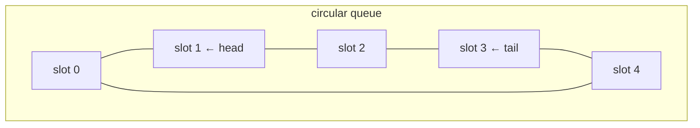

# Stacks, Queues & Deques

## What it is
Section 10.1 introduces **dynamic sets with restricted operations**: a *stack* (last-in, first-out) and a *queue* (first-in, first-out). Both are stored in arrays; the interesting details are detecting **overflow/underflow** and wrapping the queue around the end of the array.

## How it works
* **Stack** — an index `top`; `PUSH` stores at `S[top+1]`, `POP` returns `S[top]`.
* **Queue** — `head` and `tail` chase each other around a circular array of fixed size: `ENQUEUE` writes at `tail`, `DEQUEUE` reads at `head`, and both advance modulo the capacity.
* **Deque** — can insert and delete at both ends (Exercise 10.1-5).
* **Queue from two stacks** (Exercise 10.1-6) — move everything from an *inbox* stack to an *outbox* stack only when the outbox is empty: each element is moved at most once ⇒ amortised O(1).

## Complexity
All operations are Θ(1) (two-stack queue: amortised Θ(1)).

## When to use it
Stacks: expression evaluation, recursion elimination, [DFS](#/depth_first_search). Queues: scheduling and [BFS](#/breadth_first_search). Deques: sliding-window algorithms.

## In this implementation
Fixed-capacity containers return `Err("overflow")` / `Err("underflow")` exactly as the pseudocode's `error` statements do; randomised tests compare the queue and deque with `std::collections::VecDeque`.
