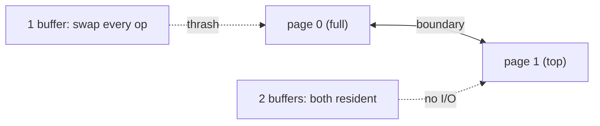

# Stacks on Secondary Storage

## What it is
A stack too large for main memory is kept on disk in **pages** of `m` items. Problem 18-1 studies how many **disk accesses** (page reads and write-backs) are needed — the question B-trees answer for search trees ([B-trees](#/b_tree)). It illustrates how a tiny change in the buffering policy changes the cost from `Θ(1)` per operation to `O(1/m)`.

## How it works
Requirement: the page containing the top of the stack must be in memory after each operation.
* **One buffered page.** Fill the stack exactly to a page boundary. A `PUSH` moves the top onto a new page (evicting and writing back the old one); the next `POP` moves the top back onto the old page (evicting and reading it again). Alternating push/pop **thrashes**: `Θ(1)` disk accesses per operation, forever.
* **Two buffered pages** (LRU): both pages around the boundary stay resident. An access to a *new* page happens only once per `m` pushes (or pops), so `n` operations cost at most `O(n/m)` accesses — **amortised `O(1/m)`** per operation, which can be proven with the potential method (potential = number of pages not yet written, or accounting credits placed on boundary crossings).

## Complexity
1 buffer page: `Θ(1)` I/Os per op (worst case); 2 pages: `O(1/m)` amortised.

## When to use it
Design of external-memory algorithms (on-disk stacks for DFS on huge graphs, undo logs), and the general lesson that a **hysteresis** (keeping a spare page) prevents oscillation costs — the same idea as the 1/4-load shrink rule in [dynamic tables](#/dynamic_table).

## In this implementation
`PagedStack` models an LRU buffer with dirty bits and counts reads and write-backs; tests show ≥ 2000 I/Os for 2000 boundary operations with one page, ≤ 4 with two pages, and about `3n/m` for a full push-then-pop sweep.
