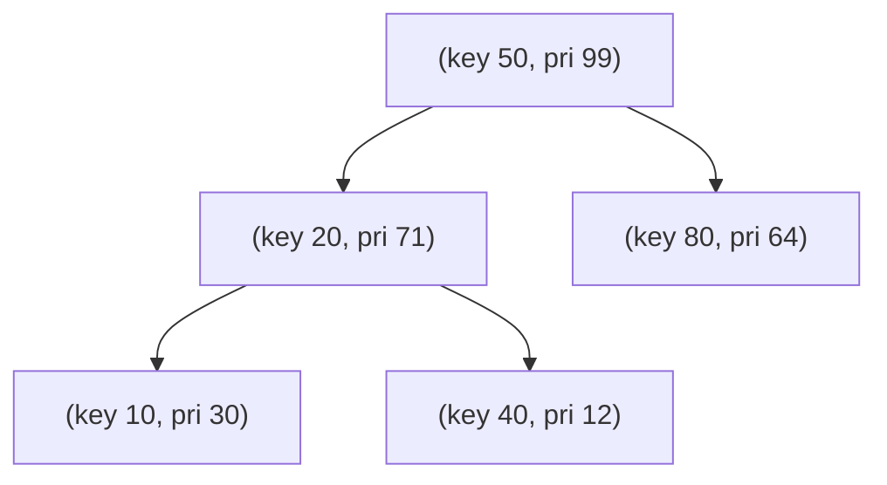

# Treaps

## What it is
A **treap** (tree + heap) gives each node a key *and* a random priority. It is a BST with respect to keys and a heap with respect to priorities. Because the priorities are random, the shape of the treap is exactly that of a [randomly built BST](#/randomly_built_bst) — **whatever order the keys arrive in** (Problem 13-4).

## How it works
* **Insert** the key as in an ordinary BST (as a leaf), then **rotate it upwards** while its priority exceeds its parent's.
* **Delete** by rotating the node *down* — always with the higher-priority child — until it is a leaf, then cut it off.
* Uniqueness lemma: for distinct keys and distinct priorities there is exactly one treap. Its root is the node of highest priority, which is a uniformly random key, so the expected depth is `O(lg n)` by the same argument as for [randomized quicksort](#/randomized_quicksort).

## Complexity
Expected O(lg n) for search, insert and delete (height is O(lg n) with high probability); `O(1)` expected rotations per update.

## When to use it
A very simple balanced tree — easy to implement, supports split/merge (so it is popular for competitive programming and as an implicit sequence structure) and works in persistent/concurrent settings.

## In this implementation
Rotation-based, with priorities drawn from the deterministic project RNG. The tests ensure the heap and BST properties after random updates and that sorted insertion still yields a short tree.
