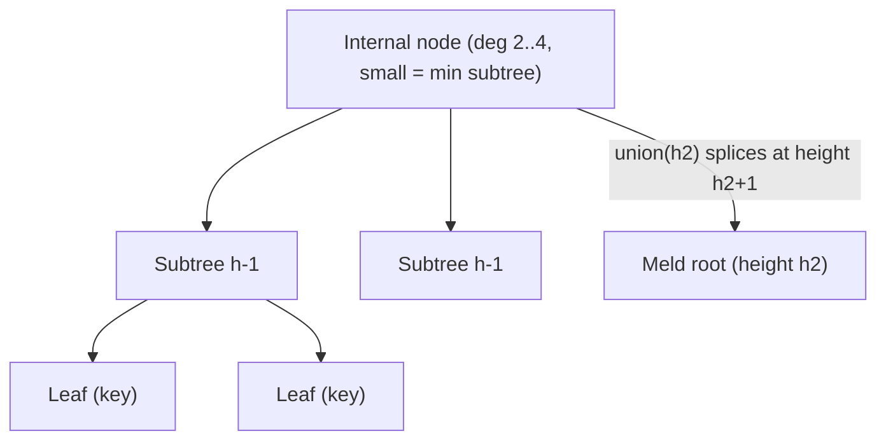

# 2-3-4 Heaps

## What it is
A **2-3-4 heap** (CLRS Problem 19-1 / 20-1) adapts the balanced height invariants of a [2-3-4 tree](#/two_three_four_tree) to implement a **mergeable priority queue** where **all 6 heap operations** — `minimum`, `insert`, `decrease_key`, `extract_min`, `delete`, and `union` (meld) — run in **$O(\lg n)$ worst-case time**, trading the $O(1)$ amortized `insert`/`decrease_key` of a [Fibonacci heap](#/fibonacci_heap) for strict worst-case logarithmic guarantees in main memory.

## How it works
Unlike search trees, keys are not ordered left-to-right across leaves:
* **Leaves only hold elements**; every leaf sits at the exact same depth `height`.
* **Internal nodes have degree $2$, $3$, or $4$** and cache `small`: the minimum key anywhere in that subtree.
* **`minimum` / `extract_min`**: Return `root.small` in $O(1)$, or follow `small` ties down from root to leaf in $O(\lg n)$ and delete that leaf.
* **`insert` / `decrease_key`**: Split full 4-nodes top-down along an insertion path to append a leaf at depth `height`, or update a leaf key and bubble `small` up to the root.
* **`delete`**: Remove the leaf and rebalance underflowing 1-child internal nodes by borrowing from a 3/4-sibling or merging with a 2-sibling upward.
* **`union` (meld)**: If the two heaps have heights $h_1 \ge h_2$, walk down the taller tree splitting any 4-nodes along the path to height $h_2 + 1$, attach the shorter root as a child so all leaves remain at uniform depth, and bubble `small` up.

## Complexity
* **`minimum`**: $O(1)$ (or $O(\lg n)$ to locate the minimum handle).
* **`insert`, `decrease_key`, `extract_min`, `delete`, `union`**: $O(\lg n)$ **worst-case** time, improving on [binomial heap](#/binomial_heap) `union`/`extract_min` when handle deletions and melds are mixed.

## When to use it
When a system needs worst-case $O(\lg n)$ latency per call — including `union` and arbitrary handle `decrease_key`/`delete` — without amortized spikes.

## In this implementation
`TwoThreeFourHeap` uses an arena of opaque leaf handles so node splits and merges never invalidate caller handles, verified with full tree-invariant checks (`degree in 2..=4`, uniform leaf depth, exact `small`) over 2,000 randomized operations against a `BTreeMap` oracle plus multi-height `union` tests.
