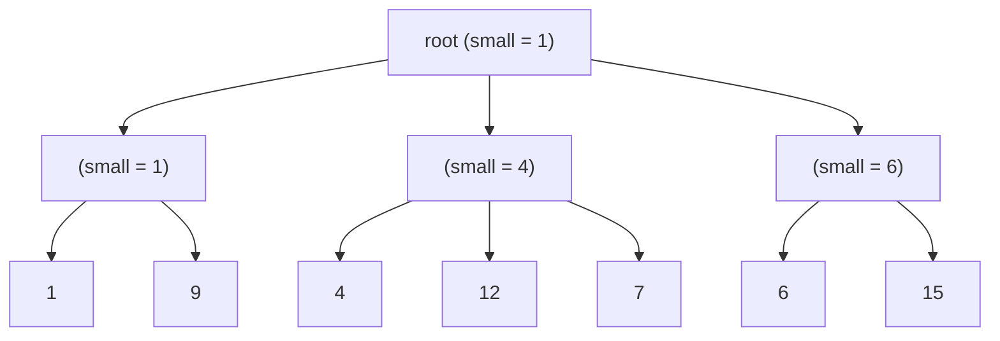

# 2-3-4 Heaps

## What it is
A **2-3-4 heap** is a mergeable heap built from a 2-3-4 tree ([Problem 18-2](#/two_three_four_tree)) with a twist: **only the leaves hold keys**, in no particular order, and every internal node `x` stores `x.small`, the smallest key among the leaves below it. Problem 19-4 asks you to implement MINIMUM, DECREASE-KEY, INSERT, DELETE, EXTRACT-MIN and UNION, each in `O(lg n)` — including `UNION`, which [Fibonacci heaps](#/fibonacci_heap) do in `O(1)` but [binary heaps](#/heap_priority_queue) in `Θ(n)`.

## How it works
* **MINIMUM:** walk from the root to a leaf, always entering the child with the smallest `small`.
* **DECREASE-KEY(x, k):** set the leaf's key and push the new minimum up the parent pointers while it improves `small`.
* **INSERT:** as in B-tree insertion ([Section 18.2](#/b_tree)), split every full (4-child) node met on the way down, so the new leaf can be attached to a height-1 node without upward propagation. Keys are unordered, so the leaf may go anywhere.
* **DELETE:** remove the leaf; if its parent is left with one child, borrow a child from a sibling with 3+ children or merge with a 2-child sibling, repeating at the parent (B-tree deletion); recompute `small` on the path; a root with one child is removed.
* **EXTRACT-MIN:** MINIMUM followed by DELETE.
* **UNION(H₁, H₂):** if the trees have equal height, make a new root over both; otherwise hang the shorter tree on the taller tree's boundary spine at the level just above its root and split overfull nodes bottom-up — the **JOIN** of Problem 18-2(b), needing no separating key because the leaves are unordered.

## Complexity
All six operations `O(lg n)`; the height is between `log₄ n` and `lg n`.

## When to use it
As a teaching device for how the **B-tree machinery** (split, borrow, merge, join) can implement a *priority queue with efficient UNION* — compare [binomial heaps](#/binomial_heap), where UNION costs `O(lg n)` as well but through carry propagation.

## In this implementation
An arena of nodes with parent pointers; leaf handles stay valid until deleted, and `union` shifts the handles of the absorbed heap by a returned offset. `validate()` checks equal leaf depth, 2–4 children per internal node, correct `small` values and parent pointers. Tests run 20 × 600 random operations (insert, decrease-key, delete, extract-min, union with random-sized heaps) against a model, validating after every step, and check logarithmic height and unions of very different sizes in both directions.
