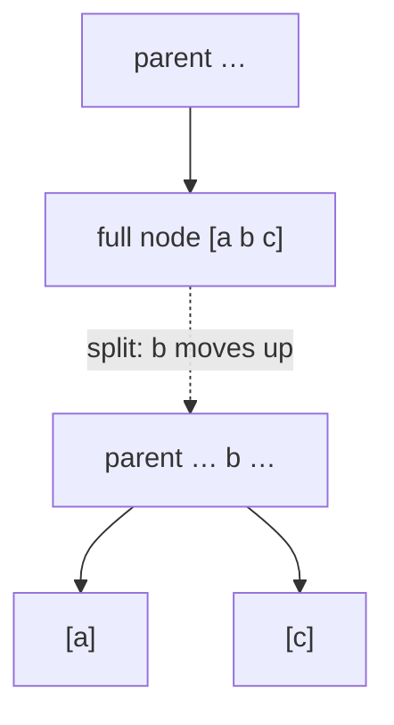

# 2-3-4 Trees

## What it is
A **2-3-4 tree** is a [B-tree](#/b_tree) with minimum degree `t = 2`: every node holds 1, 2 or 3 keys (so 2, 3 or 4 children) and all leaves are at the same depth. Problem 18-2 uses them to explain B-trees and to show how they relate to [red-black trees](#/red_black_tree): every red-black tree is a 2-3-4 tree in disguise (a black node with its red children is one 2-, 3- or 4-node), and that correspondence is how many textbooks justify the red-black rules.

## How it works
**Top-down insertion in a single pass.** Walk from the root toward the leaf where the new key belongs. Whenever the node about to be entered is **full** (3 keys), split it first: its middle key moves up into the parent (which is guaranteed to have room, because we split full nodes on the way down) and the other two keys form two separate 1-key nodes. Finally the key goes into a leaf with at most 2 keys. Because splits are made before descending, no upward propagation (and no second pass) is ever needed. The tree grows in height only when the **root** is split.

## Complexity
`O(lg n)` for search and insert; height between `⌈log₄(n+1)⌉` and `⌈lg(n+1)⌉`. Splits cost `O(1)` each and at most `lg n` happen per insertion; amortised over a sequence of insertions the number of splits is `O(1)` per insertion.

## When to use it
Mainly as a teaching device and as the model of red-black and left-leaning red-black trees; in practice the B-tree with a large branching factor (disk pages) is what is deployed.

## In this implementation
Keys are distinct `i64`s. `validate` checks key counts, ordering, child counts and equal leaf depth. Tests compare the tree with `BTreeSet` on 100 random insertion sequences (including repeated keys) and check logarithmic height for 5 000 sorted insertions.
